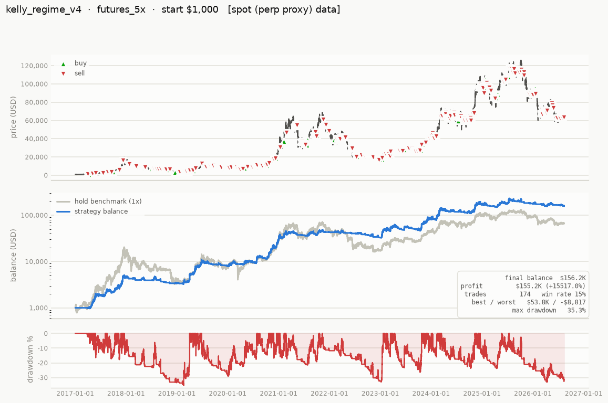
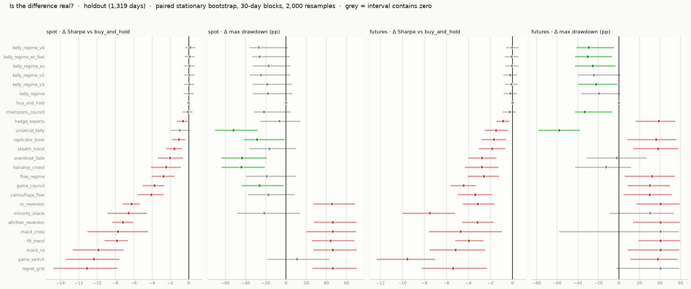
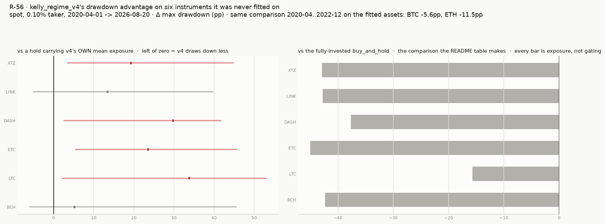

# tradebot

Paper-testing framework for BTCUSD 5-minute trading strategies. Every
registered strategy is backtested on **spot** and on **5x-leverage
futures** from a **$1,000** start, and the results are ranked by **final
balance** in one comparison table, with a chart per run (price + trades,
balance curve, drawdown, results box).

Earlier capital-scale checks found proportional results apart from exchange
minimum-order effects. The R-189 candidates were evaluated at $1,000; test
other balances with
`tradebot run --balances 1000 1000000`.

## Quick start

```bash
python -m venv .venv && . .venv/bin/activate
pip install -e ".[dev]"

tradebot run            # full matrix -> reports/comparison.md + reports/charts/
tradebot list           # show registered strategies
tradebot new my_idea    # scaffold a new strategy file
pytest                  # test suite (incl. a no-lookahead check for every strategy)
```

Real data ships with the repo (see [Data](#data)), so `tradebot run`
works out of the box. Use `--max-bars 100000` for a quick iteration loop
over the most recent ~1 year instead of the full decade.

## Where everything lives

This README is the entry point. Every other document has one job, and
anything not listed here has been folded into one of these:

| document | its one job |
|---|---|
| **[docs/ROUTINE.md](docs/ROUTINE.md)** | **The process.** The single procedure for researching and adding a strategy — from idea selection through holdout evaluation to the ledger record, including the mechanics of registering one. |
| **[docs/LEDGER.md](docs/LEDGER.md)** | **The memory.** Everything already tried — 37 registered strategies, and a research log of 192 rounds, newest first — the four binding constraints, the ruled-out list, and the ranked backlog. Read before a session, appended after it. |
| **[docs/VALIDATION.md](docs/VALIDATION.md)** | **The evidence.** The single comparison protocol and benchmark, and every robustness result: walk-forward, bootstrap intervals, deflated Sharpe, Monte Carlo stress windows, fees, funding, and the ETH replication test. |
| **[docs/STRATEGIES.md](docs/STRATEGIES.md)** | **The strategies.** What each registered strategy is, how it works, and the principles it rests on, with citations. |
| **[docs/RESEARCH.md](docs/RESEARCH.md)** | **The literature.** The survey behind the strategies, and the methodology findings that changed how this repo tests. |
| **[docs/LIVE.md](docs/LIVE.md)** | **Deployment.** Running a paper-tested strategy on Bitstamp / Binance / a custom venue, and the honest list of what live will not match. |
| [reports/comparison.md](reports/comparison.md) | Full metrics (win rate, drawdown, Sharpe, fees, ...) for the registered strategies, regenerated by `tradebot run`. The [strategy ranking](#strategy-ranking) is built from it plus the research candidates. |

Earlier rounds found that sizing and turnover control mattered more than
adding directional indicators. R-189 adds ten game-theory candidates; none
clears its frozen promotion bar. Two achieve several fills per day, but
none achieves several completed round trips per day.

## Strategy ranking

Every strategy in this repo that can be rebuilt on one dataset, in one
table, sorted by **profit**. Each name links to its implementation.

All rows use the same test: BTC 5-minute data 2017–2026, $1,000 start,
0.10% spot fees, 5× futures at 0.05%. Profit is the better of the two
markets. "from" says whether a strategy is registered or which research
round produced it (every non-registered one failed that round's test; see
[docs/LEDGER.md](docs/LEDGER.md)). Regenerate with
`python experiments/all_strategies_rank.py`.

<!-- comparison:begin -->
| # | strategy | from | profit | spot | futures 5x | max drawdown |
|---:|---|---|---:|---:|---:|---:|
| 1 | [kelly_regime_v12_cppi_conservative](experiments/kelly_regime_v12_cppi_conservative.py) | R-46 | $2,320.5K | $153.0K | $2,321.5K | 81% |
| 2 | [kelly_regime_v12_cppi_hurst](experiments/kelly_regime_v12_cppi_hurst.py) | R-46 | $2,251.5K | $151.3K | $2,252.5K | 81% |
| 3 | [kelly_regime_aci_conformal](experiments/r87_novel_aci_conformal_scale.py) | R-87 | $247.5K | $86.8K | $248.5K | 51% |
| 4 | [r179_novel_meta_sigmoid](experiments/r179_novel.py) | R-179 | $217.8K | $95.8K | $218.8K | 40% |
| 5 | [r194_residual_transformer](experiments/r194_strategies.py) | R-194 | $206.6K | $50.4K | $207.6K | 65% |
| 6 | [r177_conservative_signed_vote](experiments/r177_conservative_signed_vote.py) | R-177 | $174.4K | $46.6K | $175.4K | 41% |
| 7 | [r192_robust_state](experiments/r192_strategies.py) | R-192 | $168.6K | $64.3K | $169.6K | 36% |
| 8 | [r194_kelly_episodic_memory](experiments/r194_strategies.py) | R-194 | $160.7K | $35.3K | $161.7K | 43% |
| 9 | [r62_novel_vote_constant_exposure](experiments/r62_novel_vote_constant_exposure.py) | R-62 | $160.3K | $136.9K | $161.3K | 58% |
| 10 | [r131_conservative_turnover_band](experiments/r131_conservative_turnover_band.py) | R-131 | $157.6K | $67.3K | $158.6K | 35% |
| 11 | [r133_conservative_turnover_band](experiments/r133_mechanisms.py) | R-133 | $156.2K | $65.8K | $157.2K | 35% |
| 12 | [kelly_regime_v4](src/tradebot/strategies/kelly_regime_v4.py) | registered | $155.2K | $66.8K | $156.2K | 35% |
| 13 | [r192_tracking_budget](experiments/r192_strategies.py) | R-192 | $150.1K | $66.8K | $151.1K | 42% |
| 14 | [kelly_regime_v4_aci_conservative](experiments/r87_conservative_aci_confidence.py) | R-87 | $148.0K | $66.0K | $149.0K | 34% |
| 15 | [r84_conservative_volume_confirm](experiments/r84_conservative_volume_confirm.py) | R-84 | $144.8K | $71.3K | $145.8K | 33% |
| 16 | [r66_novel_scaled_band](experiments/r66_novel_scaled_band.py) | R-66 | $143.2K | $68.3K | $144.2K | 35% |
| 17 | [kelly_regime_v11_robust_ladder](experiments/kelly_regime_v11_robust_ladder.py) | R-45 | $142.7K | $68.9K | $143.7K | 36% |
| 18 | [r179_conservative_meta_veto](experiments/r179_conservative.py) | R-179 | $140.4K | $67.0K | $141.4K | 36% |
| 19 | [kelly_regime_v3](src/tradebot/strategies/kelly_regime_v3.py) | registered | $138.5K | $65.8K | $139.5K | 42% |
| 20 | [kelly_regime_v8_uncertainty_shrink](experiments/kelly_regime_v8_uncertainty_shrink.py) | R-40 | $135.2K | $64.7K | $136.2K | 37% |
| 21 | [r192_confirm_increase](experiments/r192_strategies.py) | R-192 | $131.9K | $59.9K | $132.9K | 37% |
| 22 | [r136_conservative_har_rv_scale](experiments/r136_conservative_har_rv_scale.py) | R-136 | $131.1K | $67.0K | $132.1K | 37% |
| 23 | [r64_novel_gp_aim_partial_adjustment](experiments/r64_novel_aim_partial_adjustment.py) | R-64 | $130.5K | $67.1K | $131.5K | 44% |
| 24 | [r190_v3_b05](experiments/r190_variations.py) | R-190 | $129.0K | $51.8K | $130.0K | 44% |
| 25 | [r190_v3_b10](experiments/r190_variations.py) | R-190 | $129.0K | $57.2K | $130.0K | 44% |
| 26 | [r190_v4_b05](experiments/r190_variations.py) | R-190 | $129.0K | $57.5K | $130.0K | 35% |
| 27 | [r190_v4_b10](experiments/r190_variations.py) | R-190 | $129.0K | $61.6K | $130.0K | 35% |
| 28 | [r66_conservative_snap_to_flat](experiments/r66_conservative_snap_to_flat.py) | R-66 | $128.8K | $67.9K | $129.8K | 37% |
| 29 | [r190_v3_b20](experiments/r190_variations.py) | R-190 | $128.3K | $51.7K | $129.3K | 43% |
| 30 | [r131_novel_turnover_throttle](experiments/r131_novel_turnover_throttle.py) | R-131 | $126.9K | $47.4K | $127.9K | 40% |
| 31 | [r133_novel_turnover_throttle](experiments/r133_mechanisms.py) | R-133 | $126.8K | $65.1K | $127.8K | 40% |
| 32 | [r192_factor_clock](experiments/r192_strategies.py) | R-192 | $126.3K | $51.8K | $127.3K | 36% |
| 33 | [r190_v4_b20](experiments/r190_variations.py) | R-190 | $124.3K | $67.1K | $125.3K | 35% |
| 34 | [kelly_regime_v2](src/tradebot/strategies/kelly_regime_v2.py) | registered | $121.0K | $46.4K | $122.0K | 40% |
| 35 | [r64_conservative_trade_to_boundary](experiments/r64_conservative_trade_to_boundary.py) | R-64 | $113.0K | $65.9K | $114.0K | 41% |
| 36 | [r194_panel_cross_attention](experiments/r194_strategies.py) | R-194 | $110.5K | $53.4K | $111.5K | 47% |
| 37 | [kelly_regime](src/tradebot/strategies/kelly_regime.py) | registered | $107.2K | $42.1K | $108.2K | 43% |
| 38 | [kelly_regime_ev](src/tradebot/strategies/kelly_regime_ev.py) | registered | $107.0K | $40.9K | $108.0K | 37% |
| 39 | [r192_anchor_confirm](experiments/r192_strategies.py) | R-192 | $102.4K | $53.6K | $103.4K | 46% |
| 40 | [r190_blend_b10](experiments/r190_variations.py) | R-190 | $94.0K | $49.9K | $95.0K | 40% |
| 41 | [kelly_regime_v8_ladder_bag](experiments/kelly_regime_v8_ladder_bag.py) | R-40 | $92.5K | $71.9K | $93.5K | 46% |
| 42 | [r190_base_b05](experiments/r190_variations.py) | R-190 | $90.8K | $39.3K | $91.8K | 44% |
| 43 | [r190_base_b10](experiments/r190_variations.py) | R-190 | $90.8K | $38.8K | $91.8K | 44% |
| 44 | [r190_base_b20](experiments/r190_variations.py) | R-190 | $85.3K | $42.7K | $86.3K | 45% |
| 45 | [kelly_regime_v6_state_kelly](experiments/kelly_regime_v6_state_kelly.py) | R-37 | $81.4K | $11.9K | $82.4K | 71% |
| 46 | [kelly_regime_v7_crra](experiments/kelly_regime_v7_crra.py) | R-38 | $75.6K | $32.1K | $76.6K | 47% |
| 47 | [kelly_regime_v4_jackknife_causal](experiments/r101_novel_jackknife_causal.py) | R-101 | $72.4K | $36.7K | $73.4K | 33% |
| 48 | [kelly_regime_ev_fast](src/tradebot/strategies/kelly_regime_ev.py) | registered | $70.1K | $71.1K | $70.8K | 32% |
| 49 | [buy_and_hold](src/tradebot/strategies/buy_and_hold.py) | registered | $65.0K | $66.0K | $18.05 | 84% |
| 50 | [elliott_confidence_kelly_v4](experiments/r157_elliott_confidence_novel.py) | R-157 | $63.9K | $40.1K | $64.9K | 36% |
| 51 | [r80_conservative_hitrate_confirm](experiments/r80_conservative_hitrate_confirm.py) | R-80 | $60.4K | $46.8K | $61.4K | 48% |
| 52 | [swap_regret_council](src/tradebot/strategies/intraday_games.py) | registered | $56.1K | $57.1K | $57.1K | 84% |
| 53 | [cautious_optimism](src/tradebot/strategies/intraday_games.py) | registered | $54.4K | $55.4K | $55.3K | 84% |
| 54 | [normalhedge_council](src/tradebot/strategies/intraday_games.py) | registered | $53.6K | $54.6K | $54.6K | 84% |
| 55 | [sleeping_council](src/tradebot/strategies/intraday_games.py) | registered | $52.8K | $53.8K | $41.6K | 84% |
| 56 | [squint_council](src/tradebot/strategies/intraday_games.py) | registered | $48.5K | $49.5K | $49.4K | 83% |
| 57 | [kelly_regime_v58_relvol](experiments/r59_novel_relative_vol_scale.py) | R-59 | $46.6K | $30.8K | $47.6K | 35% |
| 58 | [r62_conservative_voltarget_only](experiments/r62_conservative_voltarget_only.py) | R-62 | $41.8K | $27.3K | $42.8K | 74% |
| 59 | [champions_council](src/tradebot/strategies/champions_council.py) | registered | $35.8K | $19.3K | $36.8K | 37% |
| 60 | [r191_cost_proximal](experiments/r191_strategies.py) | R-191 | $34.3K | $35.3K | $28.7K | 53% |
| 61 | [kelly_regime_v5_damp](experiments/kelly_regime_v5_damp.py) | R-34 | $33.1K | $30.1K | $34.1K | 28% |
| 62 | [kelly_regime_v80_metalabel](experiments/r80_novel_metalabel_logistic.py) | R-80 | $31.6K | $22.0K | $32.6K | 34% |
| 63 | [r129_novel_bucket_band](experiments/r129_novel_bucket_band.py) | R-129 | $29.4K | $30.4K | $643 | 59% |
| 64 | [r130_cape_commission_avoidant](experiments/r130_novel_commission_avoidant.py) | R-130 | $24.2K | $25.2K | $537 | 55% |
| 65 | [r191_sticky_expert](experiments/r191_strategies.py) | R-191 | $23.8K | $24.0K | $24.8K | 74% |
| 66 | [r191_conformal_tail](experiments/r191_strategies.py) | R-191 | $22.4K | $23.4K | $21.9K | 59% |
| 67 | [r128_conservative_ev_band](experiments/r128_conservative_ev_band.py) | R-128 | $21.6K | $22.6K | $9.15 | 51% |
| 68 | [r129_conservative_per_expert_band](experiments/r129_conservative_per_expert_band.py) | R-129 | $18.3K | $19.3K | $26.53 | 56% |
| 69 | [r128_novel_adaptive_band](experiments/r128_novel_adaptive_band.py) | R-128 | $17.6K | $18.6K | $24.05 | 53% |
| 70 | [r191_robust_growth](experiments/r191_strategies.py) | R-191 | $14.5K | $15.5K | $15.0K | 78% |
| 71 | [nash_council](src/tradebot/strategies/intraday_games.py) | registered | $13.2K | $3,170 | $14.2K | 71% |
| 72 | [blackwell_council](src/tradebot/strategies/intraday_games.py) | registered | $13.1K | $10.9K | $14.1K | 58% |
| 73 | [qre_council](src/tradebot/strategies/intraday_games.py) | registered | $12.6K | $7,881 | $13.6K | 56% |
| 74 | [minimax_council](src/tradebot/strategies/intraday_games.py) | registered | $12.5K | $4,010 | $13.5K | 58% |
| 75 | [hedge_experts](src/tradebot/strategies/hedge_experts.py) | registered | $12.3K | $13.3K | $258 | 59% |
| 76 | [r193_attention](experiments/r193_strategies.py) | R-193 | $8,412 | $9,412 | $9,155 | 71% |
| 77 | [mfg_crowding](experiments/r188_mfg_crowding.py) | R-188 | $7,112 | $4,433 | $8,112 | 51% |
| 78 | [eprocess_regime](experiments/eprocess_regime.py) | R-28 | $7,102 | $8,102 | $7,881 | 21% |
| 79 | [robust_kelly](experiments/r188_robust_kelly.py) | R-188 | $5,190 | $1,889 | $6,190 | 60% |
| 80 | [elliott_wave_zigzag](src/tradebot/strategies/elliott_wave_zigzag.py) | registered | $4,027 | $5,027 | $12.75 | 44% |
| 81 | [r193_transformer](experiments/r193_strategies.py) | R-193 | $4,005 | $4,473 | $5,005 | 79% |
| 82 | [kelly_regime_v7_ddcap](experiments/kelly_regime_v7_ddcap.py) | R-38 | $3,616 | $4,616 | $3,944 | 24% |
| 83 | [kelly_regime_r60_cusum_vote](experiments/r60_novel_cusum_vote.py) | R-60 | $3,472 | $2,838 | $4,472 | 47% |
| 84 | [r93_gz_scaled_kelly](experiments/r93_shared.py) | R-93 | $2,783 | $3,783 | $2,112 | 30% |
| 85 | [coin_betting](experiments/r188_coin_betting.py) | R-188 | $1,984 | $2,904 | $2,984 | 35% |
| 86 | [r125_novel_cvar_kelly](experiments/r125_novel_cvar_kelly.py) | R-125 | $1,833 | $2,628 | $2,833 | 40% |
| 87 | [replicator_book](src/tradebot/strategies/replicator_book.py) | registered | $1,330 | $2,330 | $10.58 | 38% |
| 88 | [r177_novel_state_kelly_short](experiments/r177_novel_state_kelly_short.py) | R-177 | $1,087 | $2,087 | $66.11 | 74% |
| 89 | [defensive_forecast](src/tradebot/strategies/intraday_games.py) | registered | $999 | $1,609 | $1,999 | 14% |
| 90 | [universal_kelly](src/tradebot/strategies/universal_kelly.py) | registered | $276 | $1,276 | $1,227 | 7% |
| 91 | [r191_cost_olmar](experiments/r191_strategies.py) | R-191 | $103 | $952 | $1,103 | 60% |
| 92 | [intraday_momentum](experiments/r188_intraday_momentum.py) | R-188 | -$5.78 | $397 | $994 | 54% |
| 93 | [r193_multihead](experiments/r193_strategies.py) | R-193 | -$60.86 | $931 | $939 | 63% |
| 94 | [harsanyi_crowd](src/tradebot/strategies/harsanyi_crowd.py) | registered | -$112 | $888 | $429 | 11% |
| 95 | [overshoot_fade](src/tradebot/strategies/overshoot_fade.py) | registered | -$338 | $662 | $33.52 | 37% |
| 96 | [kelly_regime_v61_hurst_gated_reversion](experiments/r61_novel_hurst_gated_reversion.py) | R-61 | -$341 | $622 | $659 | 52% |
| 97 | [camouflage_flow](src/tradebot/strategies/camouflage_flow.py) | registered | -$452 | $548 | $0.99 | 53% |
| 98 | [kelly_regime_v5_bayes](experiments/kelly_regime_v5_bayes.py) | R-34 | -$471 | $22.54 | $529 | 63% |
| 99 | [vwap_reversion](experiments/r188_vwap_reversion.py) | R-188 | -$491 | $509 | $255 | 91% |
| 100 | [jump_momentum](experiments/r188_jump_momentum.py) | R-188 | -$519 | $455 | $481 | 64% |
| 101 | [stealth_trend](src/tradebot/strategies/stealth_trend.py) | registered | -$535 | $465 | $0.38 | 55% |
| 102 | [flow_regime](src/tradebot/strategies/flow_regime.py) | registered | -$553 | $447 | $0.80 | 56% |
| 103 | [session_drift](experiments/r188_session_drift.py) | R-188 | -$591 | $409 | $397 | 59% |
| 104 | [game_council](src/tradebot/strategies/game_council.py) | registered | -$716 | $284 | $2.00 | 72% |
| 105 | [elliott_wave](src/tradebot/strategies/elliott_wave.py) | registered | -$728 | $272 | $81.67 | 81% |
| 106 | [kelly_regime_v61_zscore_reversion](experiments/r61_conservative_zscore_reversion.py) | R-61 | -$900 | $75.30 | $99.84 | 94% |
| 107 | [minority_oracle](src/tradebot/strategies/minority_oracle.py) | registered | -$947 | $53.36 | $3.83 | 95% |
| 108 | [noise_area_breakout](experiments/r188_noise_area_breakout.py) | R-188 | -$950 | $42.26 | $49.85 | 95% |
| 109 | [level_k](experiments/r188_level_k.py) | R-188 | -$995 | $5.00 | $5.01 | 100% |
| 110 | [focal_levels](experiments/r188_focal_levels.py) | R-188 | -$995 | $4.95 | $5.00 | 100% |
| 111 | [game_switch](src/tradebot/strategies/game_switch.py) | registered | -$995 | $5.00 | $1.00 | 99% |
| 112 | [regret_grid](src/tradebot/strategies/regret_grid.py) | registered | -$995 | $5.00 | $1.00 | 100% |
| 113 | [tft_trend](src/tradebot/strategies/tft_trend.py) | registered | -$995 | $4.99 | $1.00 | 100% |
| 114 | [macd_cross](src/tradebot/strategies/macd_cross.py) | registered | -$995 | $4.99 | $1.00 | 100% |
| 115 | [macd_rsi](src/tradebot/strategies/macd_rsi.py) | registered | -$995 | $4.96 | $0.94 | 100% |
| 116 | [attrition_reversion](src/tradebot/strategies/attrition_reversion.py) | registered | -$995 | $4.94 | $0.99 | 100% |
| 117 | [rsi_reversion](src/tradebot/strategies/rsi_reversion.py) | registered | -$995 | $4.85 | $0.77 | 100% |
<!-- comparison:end -->

<details>
<summary><b>How to read these numbers</b> (leverage, funding, noise)</summary>

The ranking rewards leverage: the futures column charges no funding, and
the top rows got there with large drawdowns. Against buy-and-hold, no
strategy's growth is distinguishable from holding once a confidence
interval is attached (the intervals are in
[reports/all_strategies/ranked.csv](reports/all_strategies/ranked.csv)).

**One comparison, one benchmark.** Every strategy runs the same full
matrix — both markets, $1,000 start, 0.10% spot / 0.05% futures taker
fees — and is ranked by final balance. The benchmark every strategy must
beat is **`buy_and_hold` on spot**; leveraged buy-and-hold is not a
benchmark but a stress case, and it gets liquidated. The full protocol,
and how much of the ordering is actually signal, is in
[docs/VALIDATION.md](docs/VALIDATION.md).

Sorted **best to worst** by final balance (each strategy's best config);
every registered strategy MUST appear here — a full `tradebot run`
regenerates the table and CI fails if a strategy is missing from it.

The last two columns are the ones that matter. Everything left of them is
what happened on one path; **only they say whether it is distinguishable
from having done nothing** — and on growth, the criterion this table
ranks by, **not one of the 36 alternatives is distinguishably better than
buy-and-hold**. CI also fails if a registered strategy has no measured
interval, so a new row cannot arrive as a bare point estimate beside rows
that carry one.

> 🚨 **The `futures_5x` column ignores funding, and that is worth 2–3x.**
> Perpetuals settle funding every 8 hours; on real Binance data it was
> positive at 86.5% of settlements and cost a constant long ~15% a year.
> Charging it, `kelly_regime_v4`'s $156K becomes **$36K–$80K** depending
> on the period assumed — a band that *straddles* spot buy-and-hold's
> $66K. Worse, funding runs **+20%/yr while the strategy holds** against
> +2.8% while it is flat, because the crowding that drives the signal is
> what sets the rate. Read every futures figure below as an upper bound;
> detail in [docs/VALIDATION.md](docs/VALIDATION.md#funding-the-cost-that-was-missing-and-what-it-does),
> reproduce with `python scripts/funding_study.py all`.
>
> **And funding is not the only thing that column is measuring.** The
> broker ignores same-sign target adjustments below `REBALANCE_DEADBAND
> = 5%` of *max* notional, which at 5x leverage is **25% of equity** —
> so on futures it silently discards about **half** of a strategy's
> intended rebalances. Measured on `kelly_regime_v4` itself, intended
> rebalances become fills 86.0% / 96.2% of the time on spot but only
> **48.1% / 53.8%** on `futures_5x`. **R-72 settled how general this
> is**: measured on the 25 strategies registered then, the gap is *not* a
> general futures property (mean fill-through 62.7%/52.3% train,
> 65.6%/65.0% inner-validation — close to even) but is concentrated in
> the 8 strategies that route through `order_notional` — 7 of 8, the
> entire `kelly_regime` family plus `champions_council`, show 21–67
> percentage-point gaps; the 17 `order_target`-based strategies are
> mixed-to-reversed. A candidate fix (scale the deadband by equity
> instead of max notional) was tested in isolation and rejected: it
> restores fill-through to ~100% but makes `kelly_regime_v4`'s own
> futures growth, Sharpe and drawdown worse on the point estimate (both
> bootstrap intervals contain zero) — so no broker change was made.
> Found and reproduced three times independently in R-64; filed as
> **B-30** in [docs/LEDGER.md](docs/LEDGER.md) and closed by R-72. A
> futures figure for a `kelly_regime`-family strategy or
> `champions_council` should still be read with this caveat attached;
> that measurement concerned the other 17 strategies then registered.
> The ten R-189 additions also use equity-notional sizing and inherit
> the coarser futures rebalance band.

> 🚨 **This is a ranking of point estimates, and the ordering is mostly
> not real.** Testing every adjacent pair with a paired block bootstrap,
> the original R-29 audit found **10 of 96** adjacent differences with a
> 95% interval excluding zero —
> and none of them separates two of the table's top eight from each
> other. By the table's own criterion (final balance), `kelly_regime_v4`
> against `buy_and_hold` on spot over the full history is a **coin flip:
> P = 0.52**. In that historical audit, no strategy cleared its deflated-Sharpe
> bar against the then-counted 190 trials. R-189 separately accounts for
> its larger consultation count; those old ordering counts are not a
> fresh test of the expanded 37-strategy roster.
> The drawdown reduction does survive against *this* benchmark, on the
> full history and on the futures holdout — but read the next warning
> before reading it as a property of the strategy. Read the table as
> buckets, not as a rank order.
> **The table now carries that test in its own last two columns**, so
> this warning can be checked against the rows rather than taken on
> trust: `≈` means the difference from simply holding is not established,
> and no current alternative has a positive lower growth bound. Detail in
> [docs/VALIDATION.md](docs/VALIDATION.md#how-much-of-the-comparison-table-is-signal),
> reproduce with `python scripts/inference.py all`.

> 🚨 **The drawdown column compares a strategy holding about half the
> notional against a benchmark holding all of it, and ~90% of the gap is
> that difference.** `kelly_regime_v4` is flat on 29–44% of bars
> (measured on the inner splits); `buy_and_hold` never is. De-lever the benchmark to v4's *own* realized
> volatility — a passive long holding a constant fraction of equity, no
> gate, no forecast — and across 40 identical windows v4's median
> drawdown advantage falls from **−24.5pp to −2.9pp** on spot and from
> **−70.7pp to −5.5pp** on futures. On the 2023+ holdout, five of six
> pre-registered cells fail their risk match outright (a volatility
> targeter and a constant-exposure hold cannot stay matched across a
> regime change) and the one valid cell gives −14.2pp **[−22.7, +13.5]**,
> which contains zero. So "regime-gated sizing cuts drawdown" is
> established **against a fully-invested benchmark, and not against a
> de-levered one**. What does survive matching is a *return* advantage at
> equal risk — a median **+20.8pp / +23.8pp per window, in 82% and 90% of
> 40 windows**, replicating on ETH — and this claim **has since been
> pre-registered and confirmed (R-36)**, with a caveat the headline number
> hides: split the same 40 windows by start date and the advantage
> **shrinks roughly 10x outside the 2017–2020 bull**, to a median
> **+5.0pp / +7.4pp** in windows starting 2021 or later (win-rate 68%/82%,
> still excluding a coin flip, but the post-2021 spot subsample's own
> interval alone contains 50% at n=22). Two independent follow-up attempts
> to capture more of that thinned edge with a modified sizer — a
> hyperparameter retune and a per-regime-state Kelly fraction — both
> failed (R-37). Detail in [docs/LEDGER.md](docs/LEDGER.md) (R-33, R-36,
> R-37), reproduce with `python experiments/run_matched_hold.py windows`
> and `python experiments/b14_regime_breakdown.py`.

> 🚨 **And both of those claims are about BTC and ETH specifically — on six
> instruments the strategy was never fitted on, they invert.** R-57 ran the
> frozen `kelly_regime_v4` on BCH, LTC, ETC, DASH, LINK and XTZ (Coinbase
> 5m, 2020-04 → 2026-08). Against the fully-invested `buy_and_hold` this
> table uses, its drawdown is lower on **6 of 6**, by 16–46pp. Against a
> passive long carrying **v4's own mean exposure**, it is lower on **0 of
> 6** — the sign inverts on every asset (Δ max drawdown +5.2 to +33.8pp,
> four of six intervals excluding zero, all against v4). The equal-risk
> *return* advantage confirmed above does not reproduce either: 1 of 6 on
> the mean-notional axis, 0 of 6 on the volatility-matched one. A control
> over a window every asset shares puts BTC at −5.6pp and ETH at −11.5pp in
> v4's favour and all six panel assets against it, so the failure is
> asset-specific rather than period-specific. **Read the drawdown finding
> with its measured scope attached: BTC and ETH, 2 of 8.** Detail in
> [docs/VALIDATION.md](docs/VALIDATION.md#six-instruments-it-was-never-fitted-on-the-cross-asset-panel)
> and [docs/LEDGER.md](docs/LEDGER.md) (R-57), reproduce with
> `python experiments/r57_cross_asset_panel.py run`.

One full-history number can hide a lucky path, so the top three are also
resampled over 40 random windows
(`python scripts/stress_test.py`, charts in
[reports/stress/](reports/stress/), analysis in
[docs/VALIDATION.md](docs/VALIDATION.md)). Headline: on 5x futures,
leveraged buy-and-hold was **liquidated in 26 of 40 windows** — its median
window return is **−98%** — while the three resampled `kelly_regime`
variants (v2/v3/v4) survived **all 40**, stayed profitable in 85–88% of
them, and beat holding in 65%.

**Nothing is deleted.** Unprofitable strategies stay registered as
documented negative results: knowing that the Kyle/VPIN flow followers,
the minority-game oracle and the fictitious-play machine all lose to fees
on 5m bars is a finding, and keeping them in the table stops the same
ideas being re-tried blind. Explore variants with
`python scripts/experiment.py` (see `frontier`, `horizons`,
`walkforward`) rather than by editing a registered strategy's defaults,
so the comparison table stays a stable record.

</details>

<details>
<summary><b>Tried and dropped</b>: 63 strategies that can't be rebuilt on this dataset</summary>

These were tried, and are recorded with their results in
[docs/LEDGER.md](docs/LEDGER.md). They are **not** in the ranking because
they can't be rebuilt faithfully on this dataset:

- they need external data (funding, on-chain metrics, perpetual basis,
  implied volatility, macro series, a multi-coin universe), which doesn't
  cover the same full period;
- or they need per-round calibration or arguments;
- or their shipped defaults switch the mechanism off.

Rather than rank them on numbers that wouldn't be theirs, their code was
removed on 2026-11-19; it is still in git history. Nine controls and
ablations (passive matched holds, gate harnesses, a skeptic ablation) were
removed with them; they were never strategies.

| round | strategy | idea | why it is not ranked |
|---|---|---|---|
| R-35 | `funding_ev_band` | ``kelly_regime_ev`` with a forecast-funding-drag haircut on the target and (optionally) on the band | needs external data |
| R-39 | `funding_gate_decile` | kelly_regime_v4, unchanged, plus a binary flat-override on top-decile funding | needs external data |
| R-39 | `funding_gate_decile_ext` | R-35's gate with the extended funding series injected. No logic of its own | needs external data (btcusdt_deribit_perp_funding, btcusdt_perp_funding) |
| R-41 | `kelly_regime_v9_basis_brake` | v4's vote + conditional vol-targeting exposure, braked (never raised) by the real Deribit basis | needs external data (btcusdt_deribit_perp) |
| R-41 | `kelly_regime_v9_basis_lead` | Basis as a 4th, faster confirming vote -- accelerates the vote's | needs external data (btcusdt_deribit_perp) |
| R-44 | `kelly_regime_v10_hashribbon_vote` | v4's 3-anchor vote plus a 4th, precision-weighted Hash-Ribbons miner-capitulation vote | needs external data (btc_onchain) |
| R-44 | `kelly_regime_v10_onchain_confirm` | v4's vote + conditional vol-targeting exposure, scaled by a bounded, symmetric on-chain confirmation multiplier | needs external data (btc_onchain) |
| R-45 | `kelly_regime_v11_walkforward_adaptive` | v3/v4's unchanged vote+hysteresis-scale formula, with target_vol/max_leverage refit on a schedule | does not trade without its round's inputs |
| R-53 | `kelly_regime_v14_macro_brake` | v4's vote + conditional vol-targeting exposure, braked (never raised) by macro stress | needs external data |
| R-54 | `kelly_regime_v15_macro_veto` | B-21's mechanism: a hard, unweighted macro-veto override of v4's | needs external data |
| R-55 | `kelly_regime_v14_macro_lead` | v4's 3-anchor vote plus a 4th, precision-weighted macro-stress (VIX/DXY) vote | needs external data |
| R-55 | `kelly_regime_v14_macro_override` | Ablation: the SIMPLEST possible version of the same idea | needs external data |
| R-58 | `kelly_regime_v15_stablecoin_veto` | v4's 3-anchor vote with a hard veto: force ``frac=0`` while the | needs external data |
| R-58 | `kelly_regime_v16_stablecoin_confirm` | v4's 3-anchor vote plus a 4th, precision-weighted CONFIRMING vote | needs external data |
| R-58 | `kelly_regime_v16_stablecoin_override_ablation` | Ablation, for falsification test (3): the hard-override version of | needs external data |
| R-58 | `kelly_regime_v16_stablecoin_persist` | v4's 3-anchor vote with a hard veto identical to R-54's | needs external data |
| R-58 | `kelly_regime_v17_stablecoin_corroborate` | v4's 3-anchor vote plus a 4th, precision-weighted CONFIRMING vote, | needs external data |
| R-58 | `kelly_regime_v17_stablecoin_corroborate_override_ablation` | Ablation arm: the identical AND-gate corroboration, fed into R-54's | needs external data |
| R-58 | `kelly_regime_v17_stablecoin_shortwindow` | v4's 3-anchor vote with a hard veto identical to | needs external data |
| R-73 | `kelly_regime_v18_vrp_brake` | v4's vote + conditional vol-targeting exposure, braked (never raised) by a compressed VRP | needs external data |
| R-74 | `kelly_regime_r74_mvrv_confirm` | v4's 3-anchor vote plus a 4th, weighted CONFIRMING vote from MVRV | needs external data |
| R-76 | `_r76_pair_leg` | One leg of an R-76 distance-method pairs book | needs per-round calibration/arguments |
| R-88 | `r88_conservative_taker_flow_vote` | kelly_regime_v4 + a taker-flow-confirmed signed vote (R-88 | needs per-round calibration/arguments |
| R-89 | `r89_target` | Wrap a pure ``build_target(df) -> np.ndarray`` as a runnable strategy | needs per-round calibration/arguments |
| R-90 | `r90_target` | Wrap a pure ``build_target(df) -> np.ndarray`` as a runnable strategy | needs per-round calibration/arguments |
| R-91 | `r91_target` | Wrap a pure ``build_target(df) -> np.ndarray`` as a runnable strategy | needs per-round calibration/arguments |
| R-92 | `r92_target` | Wrap a pure ``build_target(df) -> np.ndarray`` as a runnable strategy | needs per-round calibration/arguments |
| R-93 | `r93_control` | Wrap a pure ``build_target(df) -> np.ndarray`` as a runnable strategy | needs per-round calibration/arguments |
| R-94 | `r94_conservative_attention_confirm` | kelly_regime_v4 + a Wikipedia-attention-confirmed fast-anchor vote | needs per-round calibration/arguments |
| R-95 | `r95_conservative_fgi_confirm` | kelly_regime_v4 + an FGI-extremity-confirmed fast-anchor vote (R-95 | needs per-round calibration/arguments |
| R-98 | `r98_conservative_gpd_confirm` | kelly_regime_v4 + a GPD-tail-alarm-confirmed fast-anchor vote (R-98 | needs per-round calibration/arguments |
| R-99 | `r99_conservative_bv_jump_confirm` | kelly_regime_v4 + a bipower-variation-jump-alarm-confirmed fast-anchor | needs per-round calibration/arguments |
| R-100 | `r100_conservative_funding_divergence_vote` | kelly_regime_v4 + a cross-venue funding-divergence confirming vote | needs per-round calibration/arguments |
| R-101 | `kelly_regime_v4_conservative_static_jackknife` | v4 with a third, frozen multiplicative factor: desired = frac*scale*conf | shipped defaults switch the mechanism off (identical to v4) |
| R-102 | `r102_control` | Wrap a pure ``build_target(df) -> np.ndarray`` as a runnable strategy | needs per-round calibration/arguments |
| R-116 | `r116_conservative_control` | Wrap a pure ``build_target(df) -> np.ndarray`` as a runnable | needs per-round calibration/arguments |
| R-116 | `r116_novel_control` | Wrap a pure ``build_target(df) -> np.ndarray`` as a runnable strategy | needs per-round calibration/arguments |
| R-120 | `r120_conservative_basis_level_confirm` | kelly_regime_v4 + a Deribit-calendar-basis-LEVEL-confirmed fast-anchor | needs per-round calibration/arguments |
| R-125 | `r125_conservative_cvar_scale` | kelly_regime_v4's exact architecture (3-anchor vote, 20/40/80-day | needs per-round calibration/arguments |
| R-132 | `conservative_mvrv_expert` | `hedge_experts` plus one MVRV-valuation mean-reversion vote (R-132 CONSERVATIVE) | needs external data |
| R-132 | `r132_novel_diversified_panel` | Full NOVEL construction: horizon collapse (1h+1w momentum) AND two | needs external data (btc_mvrv, stablecoin_supply) |
| R-135 | `r135_conservative_positioning_expert` | Full CONSERVATIVE construction: the unmodified 10-expert | needs external data |
| R-135 | `r135_novel_breadth_drop_only_ablation` | Ablation (pre-registered, not optional): drop the SAME two | harness-only module (asserts its round's setup) |
| R-135 | `r135_novel_breadth_optimized_panel` | Full NOVEL construction: breadth-optimized drop of the two least- | harness-only module (asserts its round's setup) |
| R-136 | `r136_novel_har_iv_scale` | kelly_regime_v4 with its EWM(8d) vol estimator replaced by | needs per-round calibration/arguments |
| R-141 | `r141_novel_lppls_dampener` | — | shipped defaults switch the mechanism off (identical to v4) |
| R-142 | `r142_novel_slope_dampener` | kelly_regime_v4's exact architecture (3-anchor vote, 20/40/80-day | shipped defaults switch the mechanism off (identical to v4) |
| R-146 | `r146_control` | Wrap a pure ``build_target(df) -> np.ndarray`` as a runnable strategy | needs per-round calibration/arguments |
| R-148 | `r148_control` | Wrap a pure ``build_target(df) -> np.ndarray`` as a runnable strategy | needs per-round calibration/arguments |
| R-149 | `r149_control` | Wrap a pure ``build_target(df) -> np.ndarray`` as a runnable strategy | needs per-round calibration/arguments |
| R-150 | `r150_control` | Wrap a pure ``build_target(df) -> np.ndarray`` as a runnable strategy | needs per-round calibration/arguments |
| R-152 | `r152_conservative_cdar_cap` | ``kelly_regime_v4`` with its fixed ``max_leverage=2.0`` replaced by | needs per-round calibration/arguments |
| R-152 | `r152_novel_cdar_budget` | ``kelly_regime_v4`` with its vol-target ratio replaced by a CDaR_0.95 | needs per-round calibration/arguments |
| R-153 | `r152_conservative_cdar_cap` | kelly_regime_v4's exact architecture with the ONE substitution this | needs per-round calibration/arguments |
| R-153 | `r152_novel_cdar_budget` | v4's vote and hysteresis latch, CDaR-budget sized: f* = min(budget / | needs per-round calibration/arguments |
| R-165 | `kelly_regime_v4_ewma_scale` | kelly_regime_v4 with an EXPONENTIALLY SMOOTHED `scale` factor | shipped defaults switch the mechanism off (identical to v4) |
| R-165 | `r165_conservative_boundary_scale` | v4 with a no-trade region, boundary destination, on ``scale`` alone | shipped defaults switch the mechanism off (identical to v4) |
| R-168 | `r168_conservative_venue_fusion` | CONSERVATIVE R-168 branch: equal-weight venue fusion, zero new | needs external data |
| R-168 | `r168_novel_venue_fusion` | kelly_regime_v4, with the vote's anchor input replaced by a | needs external data |
| R-180 | `r180_conservative_meta_veto` | `kelly_regime_v4`'s vote+scale signal, gated by a binary walk-forward | needs external data |
| R-180 | `r180_novel_betting_confidence` | v4's own `frac*scale`, continuously rescaled by a bounded function of | needs external data |
| R-185 | `r185_conservative_disagreement_veto` | CONSERVATIVE R-185 branch: bounded, never-increase disagreement veto | needs external data |
| R-185 | `r185_novel_disagreement_ensemble` | kelly_regime_v4 with its single spot vote replaced by a causal | needs external data |

</details>

### Research rounds

The per-round write-ups, with their own frozen tests and results:

- R-194, Kelly v4 × transformer hybrids: [report](reports/r194_kelly_transformer/README.md)
- R-193, attention / transformer allocators: [report](reports/r193_attention/README.md)
- R-192, five Kelly v4 improvements: [report](reports/r192_improvements/README.md)
- R-191, five cost-aware daily allocators: [report](reports/r191_strategies/README.md)
- R-190, ten execution variations of the Kelly parents: [report](reports/r190_variations/README.md)
- R-189, ten game-theory candidates: [report](reports/r189_games/README.md)

## Multi-asset strategies

<!-- multiasset:begin -->
_Period: 2020-04-01 to last bar_

| strategy | instruments | balance | vs EW hold | max DD | description |
|---|---|---|---|---|---|
| xsmom_entry_band | BCH, LTC, ETC, DASH, LINK, XTZ | 🟢 $6,534 | +348.5% | 77% ⚠️ | R-63's cross-sectional trend score under R-68's asymmetric entry band (delta_in=0.080); NEGATIVE (R-68, D1/D2 both failed), registered as B-32's infrastructure correctness check. |

_Bar-by-bar cross-asset allocators (backlog B-32): one shared cash/equity pool across the whole panel, decided at every bar's close and filled at the next bar's open — the native multi-instrument engine `tradebot.multiasset`'s own docstring says the single-asset composition path cannot express. **spot only** (`portfolio` market, 0.10% taker); a levered multi-asset book is out of scope until a shared-margin engine exists. "vs EW hold" is the final balance against an equal-weight buy-and-hold of the SAME instruments over the SAME window — the panel's own passive benchmark, not `buy_and_hold` BTC. A row here being registered is not a promotion claim by itself; see the row's own ledger entry for its verdict._
<!-- multiasset:end -->

## Research routine

New work follows one procedure, written down in
**[docs/ROUTINE.md](docs/ROUTINE.md)**: pick from the backlog, justify
which of the four binding constraints the idea attacks, tune on data
before 2023 only, then evaluate **once** on the holdout against a
default-reject promotion bar — beat buy-and-hold out-of-sample after
funding and at the real fee tier, by more than the ±0.2 Sharpe noise
floor, and survive a falsification test chosen in advance.

Everything already tried — 37 registered strategies, a research log of
190 rounds, the ruled-out list and the ranked backlog — is in
**[docs/LEDGER.md](docs/LEDGER.md)**, which is read before a session
starts and appended to when it ends. A documented negative result is a
successful session; most of the value in this repo is the record of what
does not work.

## Charts

Every run produces a chart (price with trade markers, balance curve vs a
hold benchmark, drawdown, results box). A curated set is committed; the
rest regenerate with `tradebot run` into `reports/charts/`.

**The best strategy, on 5x futures** — $1,000 → $156K where buy-and-hold
is liquidated:



**The benchmark it has to beat, on spot** — note the 84% drawdown:


**Earlier roster balance curves** (spot, $1,000 start; R-189 is charted above; the palette is
capped at eight series per chart, so the group is split into parts):


**Monte Carlo stress test** — 40 random windows, each strategy evaluated
on identical windows against buy-and-hold
([analysis](docs/VALIDATION.md)):


**Is the difference real?** — every strategy's paired difference from
buy-and-hold on the holdout, with a 95% block-bootstrap interval. Grey =
the interval contains zero, which is most of them
([analysis](docs/VALIDATION.md#how-much-of-the-comparison-table-is-signal)):



**And is the drawdown finding real?** — the same 40 windows, paired,
comparing `kelly_regime_v4` against the fully-invested benchmark every
figure above uses and against a passive long carrying v4's *own* risk in
that window. The gap between the two clouds is the part of the headline
that was never about the gate
([analysis](docs/VALIDATION.md#the-benchmark-de-levered-what-is-left-of-the-drawdown-finding)):


**Does the mechanism travel?** — the same comparison on six instruments the
strategy was never fitted on. Left: against a hold carrying v4's *own*
exposure, the advantage inverts on all six. Right: against the
fully-invested benchmark this README's table uses, all six look like wins
([analysis](docs/VALIDATION.md#six-instruments-it-was-never-fitted-on-the-cross-asset-panel)):



## Data

**Committed dataset**: `data/btcusd_spot_5m.csv.gz` — real Bitstamp
BTC/USD 5-minute candles, **2017-01-01 to 2026-08**, ~1.01M bars, no gaps.
Resampled from the 1-minute data in
[ff137/bitstamp-btcusd-minute-data](https://github.com/ff137/bitstamp-btcusd-minute-data)
(MIT-licensed, daily-updated). The span covers the 2017 bull run, 2018
bear, 2020 crash + bull, 2021 top, 2022 bear, and the 2023+ cycle, so
strategies are judged across both bull and bear regimes. Refresh it with:

```bash
git clone --depth 1 https://github.com/ff137/bitstamp-btcusd-minute-data /tmp/bitstamp
python scripts/build_bitstamp_dataset.py --source /tmp/bitstamp
```

`tradebot run` and every full-period harness load data through
`tradebot.data.load_dataset` (all `timestamp,open,high,low,close,volume`,
ms UTC epoch, `.gz` read transparently):

| priority | file | used by | label |
|---|---|---|---|
| 1 | `btcusd_spot_5m.csv.gz` (committed, 2017 →) | spot; futures run on it too | `real` / `spot (perp proxy)` |
| 2 | `synthetic_*.csv` (generated, seeded) | last resort | `SYNTHETIC` |

There is no full-history perp series, so the futures market trades the
spot series — the perp basis is small, and every table row and chart
carries the `spot (perp proxy)` label so it's never mistaken for real perp
fills. `tradebot fetch` (needs Binance network access) writes an aligned
BTCUSDT perp + spot pair (`btcusdt_perp_5m.csv`,
`btcusdt_spot_aligned_5m.csv`; the committed pair spans 2025-08 → 2026-08).
`load_dataset` deliberately ignores it, so fetching never shortens the
comparison period; load those files by path to study the real perp.

Real Binance BTCUSDT **funding rates** for 2020–2023 are also committed
(`data/btcusdt_perp_funding_8h.csv.gz`), and the ETH/BTC pair used by the
cross-asset test ships as `data/{btcusd,ethusd}_bitfinex_5m.csv.gz`.

A **six-instrument Coinbase panel** ships too — `data/{bch,ltc,etc,dash,link,xtz}usd_coinbase_spot_5m.csv.gz`,
5-minute, 2020-01 → 2026-08, plus `xrpusd_…` (excluded by R-57's continuity
rule: Coinbase suspended XRP-USD for 905 days) and `ethusd_coinbase_spot_5m.csv.gz`.
It exists so a strategy can be failed on six independent instruments before
a holdout consultation is spent on it — which is what
[R-57](docs/VALIDATION.md#six-instruments-it-was-never-fitted-on-the-cross-asset-panel)
did to this project's own incumbent. Refresh with
`python scripts/fetch_coinbase_panel.py --products BCH-USD LTC-USD …`.

## Adding a strategy

```bash
tradebot new my_strategy    # scaffold src/tradebot/strategies/my_strategy.py
pytest                      # the no-lookahead suite runs for it automatically
tradebot run --strategies my_strategy buy_and_hold --max-bars 100000   # quick compare
```

The strategy API, the two CI-enforced rules (a docstring describing the
idea, and presence in the comparison table above), and the research
procedure a new idea is expected to follow are all in one place:
**[docs/ROUTINE.md](docs/ROUTINE.md)**.

## Running it live

Strategies are pure decision functions over (candle history, account
state) — no backtest types leak into their API — so the class you
paper-tested is the class you deploy. Ready-made spot adapters ship in
the repo (`BinanceSpot`, `BitstampSpot`; stdlib only, `dry_run=True` by
default) plus a stateless one-cycle bot loop, and CI proves the top
strategies compute the identical target from paged exchange data as from
the backtest frame — and that neither adapter ever hands a strategy the
forming candle. Setup, custom venues (including 3Commas), cold-start
cost and the honest list of what live will *not* match:
**[docs/LIVE.md](docs/LIVE.md)**.

> ⚠️ **Fees decide this.** Every table here assumes a 0.10% taker fee,
> and the break-even is **0.104%** — the published spot edge lives
> entirely inside that margin. At Bitstamp's 0.40% entry tier no strategy
> here beats buy-and-hold ($29.5K vs $65.8K for `kelly_regime_v4`);
> climbing to its $5M/30d taker tier still misses by 4%. Tuning around it
> fails walk-forward: 28 of 32 configurations beat holding in-sample,
> **0 of 28** out-of-sample. Reproduce with `scripts/fee_study.py`;
> analysis in
> [docs/LIVE.md](docs/LIVE.md#read-this-before-trading-bitstamp-spot-at-the-entry-fee-tier).

## How the simulation works

- Signals are computed at a bar's **close**; orders fill at the **next
  bar's open** (no lookahead — enforced by tests that truncate future
  data and compare fills).
- **Spot**: long-only, 1x, 0.10% taker fee.
- **Futures**: long/short at configurable leverage (default 5x), 0.05%
  taker fee, cross-margin liquidation at a 0.5% maintenance-margin rate.
  Liquidation uses the analytic liquidation price, checked first at each
  bar's open (before queued orders fill, so a gap through the bankruptcy
  price can never lose more than the account holds) and then against the
  bar's high/low. Accounts floor at zero; a liquidated run stops trading
  and is flagged in the table.
- `order_target(f)` moves the position to `f` × max notional
  (equity × leverage), `f` ∈ [-1, 1] (clamped to [0, 1] on spot).
  Same-sign re-targets inside a 5% deadband are ignored so strategies
  may re-emit their target every bar without churning fees.
- Exchange-style **minimum order notional** ($5) — dust orders are
  skipped (reduces are always allowed).
- Optional slippage (`--slippage-bps`).
- Simplifications: funding rates are not charged in the default
  comparison run (the engine models them as a first-class cost — see
  `scripts/funding_study.py` and the README funding warning), taker-only
  fills, fills always succeed at open ± slippage (no order book depth).

## CLI

```
tradebot run [--balances 1000 1000000] [--markets spot futures]
             [--leverage 5] [--strategies macd_cross ...]
             [--slippage-bps 1] [--spot-fee 0.001] [--futures-fee 0.0005]
             [--max-bars 100000] [--data-dir data] [--out reports]
tradebot list
tradebot new <name>
tradebot fetch [--start 2020-01-01] [--end 2026-08-01] [--symbol BTCUSDT]
```

Outputs: `reports/comparison.md` (+ `.csv`) ranked by final balance per
(market, start balance) group, `reports/charts/<strategy>__<market>__<balance>.png`
per run, and `reports/charts/_all__<market>__<balance>.png` overlaying
all strategies' balance curves (split into `_part1.png`, `_part2.png`, …
past eight strategies).
