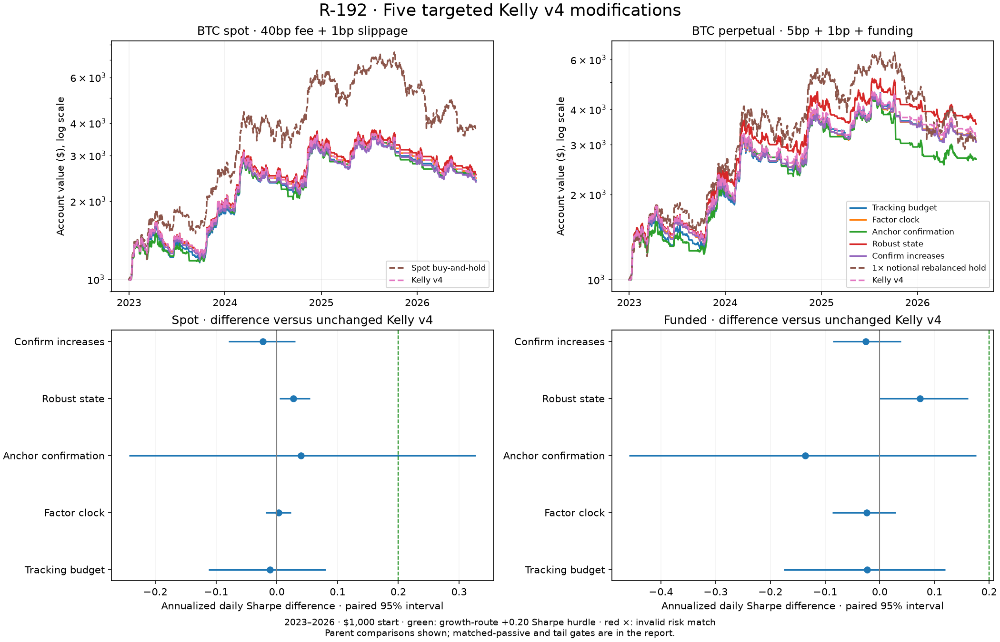
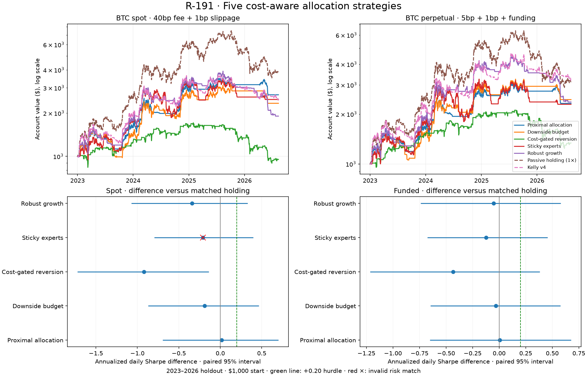
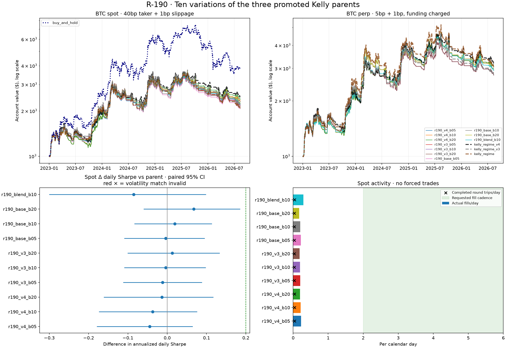
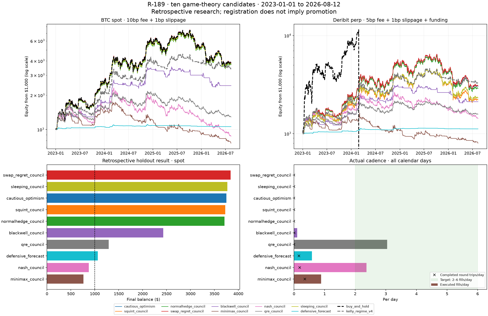
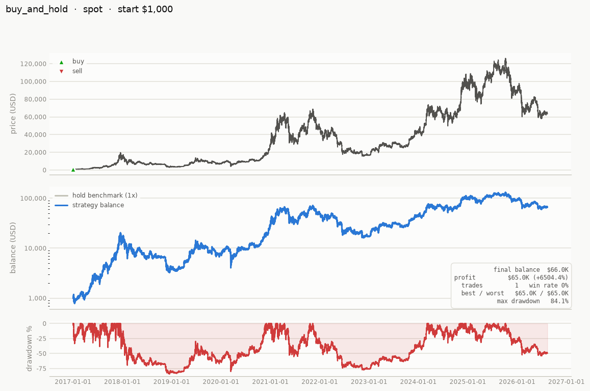
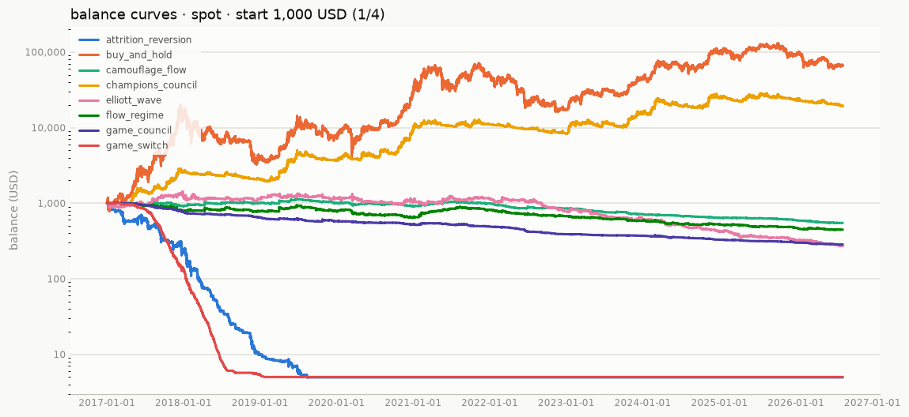
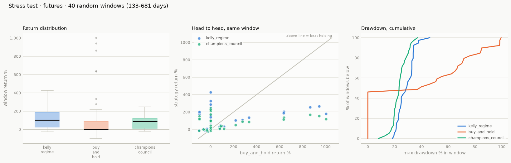
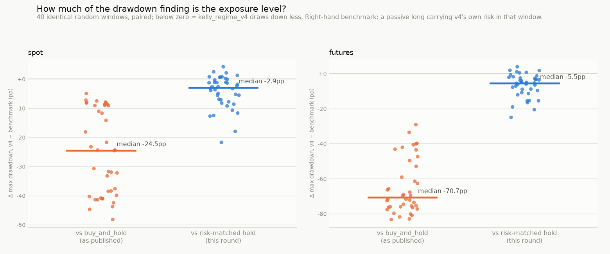

# tradebot

Paper-testing framework for BTCUSD 5-minute trading strategies. Every
registered strategy is backtested on **spot** and on **5x-leverage
futures** from a **$1,000** start, and the results are ranked by **final
balance** in one comparison table, with a chart per run (price + trades,
balance curve, drawdown, results box).

Earlier capital-scale checks found proportional results apart from exchange
minimum-order effects. The R-189 candidates were evaluated at $1,000; test
other balances with
`tradebot run --balances 1000 1000000`.

## Quick start

```bash
python -m venv .venv && . .venv/bin/activate
pip install -e ".[dev]"

tradebot run            # full matrix -> reports/comparison.md + reports/charts/
tradebot list           # show registered strategies
tradebot new my_idea    # scaffold a new strategy file
pytest                  # test suite (incl. a no-lookahead check for every strategy)
```

Real data ships with the repo (see [Data](#data)), so `tradebot run`
works out of the box. Use `--max-bars 100000` for a quick iteration loop
over the most recent ~1 year instead of the full decade.

## Where everything lives

This README is the entry point. Every other document has one job, and
anything not listed here has been folded into one of these:

| document | its one job |
|---|---|
| **[docs/ROUTINE.md](docs/ROUTINE.md)** | **The process.** The single procedure for researching and adding a strategy — from idea selection through holdout evaluation to the ledger record, including the mechanics of registering one. |
| **[docs/LEDGER.md](docs/LEDGER.md)** | **The memory.** Everything already tried — 37 registered strategies, and a research log of 192 rounds, newest first — the four binding constraints, the ruled-out list, and the ranked backlog. Read before a session, appended after it. |
| **[docs/VALIDATION.md](docs/VALIDATION.md)** | **The evidence.** The single comparison protocol and benchmark, and every robustness result: walk-forward, bootstrap intervals, deflated Sharpe, Monte Carlo stress windows, fees, funding, and the ETH replication test. |
| **[docs/STRATEGIES.md](docs/STRATEGIES.md)** | **The strategies.** What each registered strategy is, how it works, and the principles it rests on, with citations. |
| **[docs/RESEARCH.md](docs/RESEARCH.md)** | **The literature.** The survey behind the strategies, and the methodology findings that changed how this repo tests. |
| **[docs/LIVE.md](docs/LIVE.md)** | **Deployment.** Running a paper-tested strategy on Bitstamp / Binance / a custom venue, and the honest list of what live will not match. |
| [reports/comparison.md](reports/comparison.md) | Full metrics (win rate, drawdown, Sharpe, fees, ...) behind the table below. Regenerated by `tradebot run`. |

Earlier rounds found that sizing and turnover control mattered more than
adding directional indicators. R-189 adds ten game-theory candidates; none
clears its frozen promotion bar. Two achieve several fills per day, but
none achieves several completed round trips per day.

## Strategy comparison

**One comparison, one benchmark.** Every strategy runs the same full
matrix — both markets, $1,000 start, 0.10% spot / 0.05% futures taker
fees — and is ranked by final balance. The benchmark every strategy must
beat is **`buy_and_hold` on spot**; leveraged buy-and-hold is not a
benchmark but a stress case, and it gets liquidated. The full protocol,
and how much of the ordering is actually signal, is in
[docs/VALIDATION.md](docs/VALIDATION.md).

Sorted **best to worst** by final balance (each strategy's best config);
every registered strategy MUST appear here — a full `tradebot run`
regenerates the table and CI fails if a strategy is missing from it.

The last two columns are the ones that matter. Everything left of them is
what happened on one path; **only they say whether it is distinguishable
from having done nothing** — and on growth, the criterion this table
ranks by, **not one of the 36 alternatives is distinguishably better than
buy-and-hold**. CI also fails if a registered strategy has no measured
interval, so a new row cannot arrive as a bare point estimate beside rows
that carry one.

> 🚨 **The `futures_5x` column ignores funding, and that is worth 2–3x.**
> Perpetuals settle funding every 8 hours; on real Binance data it was
> positive at 86.5% of settlements and cost a constant long ~15% a year.
> Charging it, `kelly_regime_v4`'s $156K becomes **$36K–$80K** depending
> on the period assumed — a band that *straddles* spot buy-and-hold's
> $66K. Worse, funding runs **+20%/yr while the strategy holds** against
> +2.8% while it is flat, because the crowding that drives the signal is
> what sets the rate. Read every futures figure below as an upper bound;
> detail in [docs/VALIDATION.md](docs/VALIDATION.md#funding-the-cost-that-was-missing-and-what-it-does),
> reproduce with `python scripts/funding_study.py all`.
>
> **And funding is not the only thing that column is measuring.** The
> broker ignores same-sign target adjustments below `REBALANCE_DEADBAND
> = 5%` of *max* notional, which at 5x leverage is **25% of equity** —
> so on futures it silently discards about **half** of a strategy's
> intended rebalances. Measured on `kelly_regime_v4` itself, intended
> rebalances become fills 86.0% / 96.2% of the time on spot but only
> **48.1% / 53.8%** on `futures_5x`. **R-72 settled how general this
> is**: measured on the 25 strategies registered then, the gap is *not* a
> general futures property (mean fill-through 62.7%/52.3% train,
> 65.6%/65.0% inner-validation — close to even) but is concentrated in
> the 8 strategies that route through `order_notional` — 7 of 8, the
> entire `kelly_regime` family plus `champions_council`, show 21–67
> percentage-point gaps; the 17 `order_target`-based strategies are
> mixed-to-reversed. A candidate fix (scale the deadband by equity
> instead of max notional) was tested in isolation and rejected: it
> restores fill-through to ~100% but makes `kelly_regime_v4`'s own
> futures growth, Sharpe and drawdown worse on the point estimate (both
> bootstrap intervals contain zero) — so no broker change was made.
> Found and reproduced three times independently in R-64; filed as
> **B-30** in [docs/LEDGER.md](docs/LEDGER.md) and closed by R-72. A
> futures figure for a `kelly_regime`-family strategy or
> `champions_council` should still be read with this caveat attached;
> that measurement concerned the other 17 strategies then registered.
> The ten R-189 additions also use equity-notional sizing and inherit
> the coarser futures rebalance band.

> 🚨 **This is a ranking of point estimates, and the ordering is mostly
> not real.** Testing every adjacent pair with a paired block bootstrap,
> the original R-29 audit found **10 of 96** adjacent differences with a
> 95% interval excluding zero —
> and none of them separates two of the table's top eight from each
> other. By the table's own criterion (final balance), `kelly_regime_v4`
> against `buy_and_hold` on spot over the full history is a **coin flip:
> P = 0.52**. In that historical audit, no strategy cleared its deflated-Sharpe
> bar against the then-counted 190 trials. R-189 separately accounts for
> its larger consultation count; those old ordering counts are not a
> fresh test of the expanded 37-strategy roster.
> The drawdown reduction does survive against *this* benchmark, on the
> full history and on the futures holdout — but read the next warning
> before reading it as a property of the strategy. Read the table as
> buckets, not as a rank order.
> **The table now carries that test in its own last two columns**, so
> this warning can be checked against the rows rather than taken on
> trust: `≈` means the difference from simply holding is not established,
> and no current alternative has a positive lower growth bound. Detail in
> [docs/VALIDATION.md](docs/VALIDATION.md#how-much-of-the-comparison-table-is-signal),
> reproduce with `python scripts/inference.py all`.

> 🚨 **The drawdown column compares a strategy holding about half the
> notional against a benchmark holding all of it, and ~90% of the gap is
> that difference.** `kelly_regime_v4` is flat on 29–44% of bars
> (measured on the inner splits); `buy_and_hold` never is. De-lever the benchmark to v4's *own* realized
> volatility — a passive long holding a constant fraction of equity, no
> gate, no forecast — and across 40 identical windows v4's median
> drawdown advantage falls from **−24.5pp to −2.9pp** on spot and from
> **−70.7pp to −5.5pp** on futures. On the 2023+ holdout, five of six
> pre-registered cells fail their risk match outright (a volatility
> targeter and a constant-exposure hold cannot stay matched across a
> regime change) and the one valid cell gives −14.2pp **[−22.7, +13.5]**,
> which contains zero. So "regime-gated sizing cuts drawdown" is
> established **against a fully-invested benchmark, and not against a
> de-levered one**. What does survive matching is a *return* advantage at
> equal risk — a median **+20.8pp / +23.8pp per window, in 82% and 90% of
> 40 windows**, replicating on ETH — and this claim **has since been
> pre-registered and confirmed (R-36)**, with a caveat the headline number
> hides: split the same 40 windows by start date and the advantage
> **shrinks roughly 10x outside the 2017–2020 bull**, to a median
> **+5.0pp / +7.4pp** in windows starting 2021 or later (win-rate 68%/82%,
> still excluding a coin flip, but the post-2021 spot subsample's own
> interval alone contains 50% at n=22). Two independent follow-up attempts
> to capture more of that thinned edge with a modified sizer — a
> hyperparameter retune and a per-regime-state Kelly fraction — both
> failed (R-37). Detail in [docs/LEDGER.md](docs/LEDGER.md) (R-33, R-36,
> R-37), reproduce with `python experiments/run_matched_hold.py windows`
> and `python experiments/b14_regime_breakdown.py`.

> 🚨 **And both of those claims are about BTC and ETH specifically — on six
> instruments the strategy was never fitted on, they invert.** R-57 ran the
> frozen `kelly_regime_v4` on BCH, LTC, ETC, DASH, LINK and XTZ (Coinbase
> 5m, 2020-04 → 2026-08). Against the fully-invested `buy_and_hold` this
> table uses, its drawdown is lower on **6 of 6**, by 16–46pp. Against a
> passive long carrying **v4's own mean exposure**, it is lower on **0 of
> 6** — the sign inverts on every asset (Δ max drawdown +5.2 to +33.8pp,
> four of six intervals excluding zero, all against v4). The equal-risk
> *return* advantage confirmed above does not reproduce either: 1 of 6 on
> the mean-notional axis, 0 of 6 on the volatility-matched one. A control
> over a window every asset shares puts BTC at −5.6pp and ETH at −11.5pp in
> v4's favour and all six panel assets against it, so the failure is
> asset-specific rather than period-specific. **Read the drawdown finding
> with its measured scope attached: BTC and ETH, 2 of 8.** Detail in
> [docs/VALIDATION.md](docs/VALIDATION.md#six-instruments-it-was-never-fitted-on-the-cross-asset-panel)
> and [docs/LEDGER.md](docs/LEDGER.md) (R-57), reproduce with
> `python experiments/r57_cross_asset_panel.py run`.

One full-history number can hide a lucky path, so the top three are also
resampled over 40 random windows
(`python scripts/stress_test.py`, charts in
[reports/stress/](reports/stress/), analysis in
[docs/VALIDATION.md](docs/VALIDATION.md)). Headline: on 5x futures,
leveraged buy-and-hold was **liquidated in 26 of 40 windows** — its median
window return is **−98%** — while the three resampled `kelly_regime`
variants (v2/v3/v4) survived **all 40**, stayed profitable in 85–88% of
them, and beat holding in 65%.

<!-- comparison:begin -->
_Period: 2017-01-01 to 2026-08-12 (1,010,889 x 5m bars) · data: real, spot (perp proxy)_

| # | strategy | spot | futures_5x | trades | profit | max DD | growth vs hold (spot) | max DD vs hold (spot) |
|---|---|---|---|---|---|---|---|---|
| 🥇1 | [kelly_regime_v4](src/tradebot/strategies/kelly_regime_v4.py) | 🟢 $66.8K | 🟢 **$156.2K** | 174 | 📈 $155.2K | 35% | ≈ +0.04 [-2.60, +2.85] | ▲ -41.1pp [-54.8, -18.4] |
| 🥈2 | [kelly_regime_v3](src/tradebot/strategies/kelly_regime_v3.py) | 🟢 $65.8K | 🟢 **$139.5K** | 147 | 📈 $138.5K | 42% | ≈ +0.03 [-2.54, +2.81] | ▲ -36.8pp [-53.4, -16.1] |
| 🥉3 | [kelly_regime_v2](src/tradebot/strategies/kelly_regime_v2.py) | 🟢 $46.4K | 🟢 **$122.0K** | 113 | 📈 $121.0K | 40% | ≈ -0.32 [-3.15, +2.62] | ▲ -43.4pp [-54.7, -15.3] |
| 4 | [kelly_regime](src/tradebot/strategies/kelly_regime.py) | 🟢 $42.1K | 🟢 **$108.2K** | 143 | 📈 $107.2K | 43% | ≈ -0.42 [-3.08, +2.36] | ▲ -38.9pp [-50.3, -12.2] |
| 5 | [kelly_regime_ev](src/tradebot/strategies/kelly_regime_ev.py) | 🟢 $40.9K | 🟢 **$108.0K** | 135 | 📈 $107.0K | 37% | ≈ -0.45 [-3.28, +2.58] | ▲ -40.0pp [-55.5, -16.3] |
| 6 | [kelly_regime_ev_fast](src/tradebot/strategies/kelly_regime_ev.py) | 🟢 **$71.1K** | 🟢 $70.8K | 34 | 📈 $70.1K | 32% | ≈ +0.11 [-3.08, +3.29] | ▲ -52.9pp [-62.9, -20.7] |
| 7 | [buy_and_hold](src/tradebot/strategies/buy_and_hold.py) | 🟢 **$66.0K** | 💀 $18.05 | 1 | 📈 $65.0K | 84% ⚠️ | benchmark | benchmark |
| 8 | [swap_regret_council](src/tradebot/strategies/intraday_games.py) | 🟢 **$57.1K** | 🟢 $57.1K | 1 | 📈 $56.1K | 84% ⚠️ | ≈ -0.11 [-0.70, +0.33] | ≈ -0.0pp [-4.2, +4.4] |
| 9 | [cautious_optimism](src/tradebot/strategies/intraday_games.py) | 🟢 **$55.4K** | 🟢 $55.3K | 1 | 📈 $54.4K | 84% ⚠️ | ≈ -0.14 [-0.73, +0.31] | ≈ -0.2pp [-4.3, +4.4] |
| 10 | [normalhedge_council](src/tradebot/strategies/intraday_games.py) | 🟢 **$54.6K** | 🟢 $54.6K | 1 | 📈 $53.6K | 84% ⚠️ | ≈ -0.16 [-0.74, +0.30] | ≈ -0.2pp [-4.4, +4.3] |
| 11 | [sleeping_council](src/tradebot/strategies/intraday_games.py) | 🟢 **$53.8K** | 🟢 $41.6K | 2 | 📈 $52.8K | 84% ⚠️ | ≈ -0.17 [-0.76, +0.30] | ≈ -0.1pp [-4.5, +4.4] |
| 12 | [squint_council](src/tradebot/strategies/intraday_games.py) | 🟢 **$49.5K** | 🟢 $49.4K | 1 | 📈 $48.5K | 83% ⚠️ | ≈ -0.25 [-0.86, +0.24] | ≈ -0.8pp [-4.8, +4.0] |
| 13 | [champions_council](src/tradebot/strategies/champions_council.py) | 🟢 $19.3K | 🟢 **$36.8K** | 261 | 📈 $35.8K | 37% | ≈ -1.20 [-4.06, +1.81] | ▲ -49.5pp [-54.7, -19.0] |
| 14 | [nash_council](src/tradebot/strategies/intraday_games.py) | 🟢 $3,170 | 🟢 **$14.2K** | 726 | 📈 $13.2K | 71% ⚠️ | ▼ -3.00 [-5.05, -0.76] | ≈ -2.3pp [-20.1, +17.3] |
| 15 | [blackwell_council](src/tradebot/strategies/intraday_games.py) | 🟢 $10.9K | 🟢 **$14.1K** | 51 | 📈 $13.1K | 58% ⚠️ | ≈ -1.77 [-5.09, +1.38] | ▲ -26.1pp [-56.0, -12.4] |
| 16 | [qre_council](src/tradebot/strategies/intraday_games.py) | 🟢 $7,881 | 🟢 **$13.6K** | 1 | 📈 $12.6K | 56% ⚠️ | ≈ -2.09 [-4.49, +0.34] | ▲ -25.0pp [-36.7, -6.8] |
| 17 | [minimax_council](src/tradebot/strategies/intraday_games.py) | 🟢 $4,010 | 🟢 **$13.5K** | 1,179 | 📈 $12.5K | 58% ⚠️ | ≈ -2.77 [-6.07, +0.62] | ≈ -21.5pp [-41.9, +11.5] |
| 18 | [hedge_experts](src/tradebot/strategies/hedge_experts.py) | 🟢 **$13.3K** | 🔴 $258 | 2,044 | 📈 $12.3K | 59% ⚠️ | ≈ -1.57 [-4.01, +0.96] | ▲ -24.1pp [-39.1, -3.0] |
| 19 | [elliott_wave_zigzag](src/tradebot/strategies/elliott_wave_zigzag.py) | 🟢 **$5,027** | 💀 $12.75 | 162 | 📈 $4,027 | 44% | ≈ -2.54 [-6.51, +1.49] | ≈ -43.8pp [-50.7, +2.9] |
| 20 | [replicator_book](src/tradebot/strategies/replicator_book.py) | 🟢 **$2,330** | 🔴 $10.58 | 713 | 📈 $1,330 | 38% | ≈ -3.31 [-6.86, +0.28] | ▲ -47.1pp [-57.9, -20.7] |
| 21 | [defensive_forecast](src/tradebot/strategies/intraday_games.py) | 🟢 $1,609 | 🟢 **$1,999** | 796 | 📈 $999 | 14% | ≈ -3.68 [-7.93, +0.51] | ▲ -67.2pp [-82.5, -45.0] |
| 22 | [universal_kelly](src/tradebot/strategies/universal_kelly.py) | 🟢 **$1,276** | 🟢 $1,227 | 9 | 📈 $276 | 7% | ≈ -3.91 [-8.39, +0.44] | ▲ -76.6pp [-89.1, -52.9] |
| 23 | [harsanyi_crowd](src/tradebot/strategies/harsanyi_crowd.py) | 🔴 **$888** | 🔴 $429 | 91 | 📉 -$112 | 11% | ≈ -4.28 [-8.88, +0.23] | ▲ -71.9pp [-85.6, -46.0] |
| 24 | [overshoot_fade](src/tradebot/strategies/overshoot_fade.py) | 🔴 **$662** | 🔴 $33.52 | 189 | 📉 -$338 | 37% | ▼ -4.57 [-9.13, -0.07] | ▲ -46.6pp [-68.5, -19.6] |
| 25 | [camouflage_flow](src/tradebot/strategies/camouflage_flow.py) | 🔴 **$548** | 🔴 $0.99 | 802 | 📉 -$452 | 53% ⚠️ | ▼ -4.76 [-9.23, -0.29] | ▲ -31.4pp [-57.7, -2.5] |
| 26 | [stealth_trend](src/tradebot/strategies/stealth_trend.py) | 🔴 **$465** | 🔴 $0.38 | 1,605 | 📉 -$535 | 55% ⚠️ | ▼ -4.92 [-9.26, -0.76] | ≈ -29.0pp [-43.9, +12.1] |
| 27 | [flow_regime](src/tradebot/strategies/flow_regime.py) | 🔴 **$447** | 🔴 $0.80 | 1,184 | 📉 -$553 | 56% ⚠️ | ▼ -4.96 [-9.43, -0.54] | ≈ -27.3pp [-47.2, +6.3] |
| 28 | [game_council](src/tradebot/strategies/game_council.py) | 🔴 **$284** | 🔴 $2.00 | 2,541 | 📉 -$716 | 72% ⚠️ | ▼ -5.42 [-9.97, -0.95] | ≈ -11.5pp [-25.9, +12.4] |
| 29 | [elliott_wave](src/tradebot/strategies/elliott_wave.py) | 🔴 **$272** | 💀 $81.67 | 1,261 | 📉 -$728 | 81% ⚠️ | ▼ -5.46 [-9.80, -1.00] | ≈ -2.9pp [-33.6, +22.3] |
| 30 | [minority_oracle](src/tradebot/strategies/minority_oracle.py) | 🔴 **$53.36** | 🔴 $3.83 | 9,039 | 📉 -$947 | 95% ⚠️ | ▼ -7.09 [-11.60, -2.52] | ≈ +11.5pp [-3.8, +35.9] |
| 31 | [game_switch](src/tradebot/strategies/game_switch.py) | 🔴 **$5.00** | 🔴 $1.00 | 6,672 | 📉 -$995 | 99% ⚠️ | ▼ -9.45 [-15.38, -4.06] | ▼ +16.3pp [+1.0, +39.3] |
| 32 | [regret_grid](src/tradebot/strategies/regret_grid.py) | 🔴 **$5.00** | 🔴 $1.00 | 3,461 | 📉 -$995 | 100% ⚠️ | ▼ -9.46 [-16.20, -3.49] | ▼ +16.3pp [+0.9, +39.9] |
| 33 | [tft_trend](src/tradebot/strategies/tft_trend.py) | 🔴 **$4.99** | 🔴 $1.00 | 2,538 | 📉 -$995 | 100% ⚠️ | ▼ -9.46 [-14.88, -4.58] | ▼ +16.3pp [+3.0, +39.9] |
| 34 | [macd_cross](src/tradebot/strategies/macd_cross.py) | 🔴 **$4.99** | 🔴 $1.00 | 4,301 | 📉 -$995 | 100% ⚠️ | ▼ -9.47 [-16.93, -3.21] | ≈ +16.4pp [-1.4, +40.0] |
| 35 | [macd_rsi](src/tradebot/strategies/macd_rsi.py) | 🔴 **$4.96** | 🔴 $0.94 | 2,454 | 📉 -$995 | 100% ⚠️ | ▼ -9.46 [-15.00, -4.40] | ▼ +16.3pp [+2.6, +39.6] |
| 36 | [attrition_reversion](src/tradebot/strategies/attrition_reversion.py) | 🔴 **$4.94** | 🔴 $0.99 | 2,930 | 📉 -$995 | 100% ⚠️ | ▼ -9.47 [-14.55, -4.69] | ▼ +16.3pp [+3.1, +39.1] |
| 37 | [rsi_reversion](src/tradebot/strategies/rsi_reversion.py) | 🔴 **$4.85** | 🔴 $0.77 | 4,464 | 📉 -$995 | 100% ⚠️ | ▼ -9.49 [-13.24, -5.78] | ▼ +16.7pp [+3.5, +39.8] |

_Balances from a $1,000 start · bold = the strategy's better market · 🟢 profit · 🔴 loss · 💀 liquidated · ⚠️ drawdown over 50%. Trades, profit and max drawdown describe that market._

_The last two columns are the only ones that answer **"is this difference real?"** Both are paired differences against `buy_and_hold` on spot over the full period (3,510 daily observations), each with a 95% stationary block-bootstrap interval — 30-day mean block, 2,000 resamples, the identical resample applied to both strategies so the market's own variance cancels instead of swamping the gap. ▲ / ▼ = the interval excludes zero and the strategy is better / worse; **≈ = it contains zero, so the difference from simply holding is not established**._

_**Growth**, not Sharpe, because final balance is what this table ranks by — and the two disagree. **spot**, because leveraged buy-and-hold is a stress case rather than a benchmark: it is liquidated in early 2017, and an account that cannot draw down further is not something to draw down less than (R-22). On this run **0 of 36** strategies are distinguishably better than holding on growth; the drawdown column is where the project's findings actually live._

_Regenerate with `python scripts/inference.py`; the numbers live in `reports/inference/bootstrap.csv`._
<!-- comparison:end -->

**Nothing is deleted.** Unprofitable strategies stay registered as
documented negative results: knowing that the Kyle/VPIN flow followers,
the minority-game oracle and the fictitious-play machine all lose to fees
on 5m bars is a finding, and keeping them in the table stops the same
ideas being re-tried blind. Explore variants with
`python scripts/experiment.py` (see `frontier`, `horizons`,
`walkforward`) rather than by editing a registered strategy's defaults,
so the comparison table stays a stable record.

## Every strategy tried, ranked by profit (117)

This table holds every strategy in this repo that can be rebuilt faithfully:
37 registered and 80 evaluated candidates. The candidates come
from R-28 to R-194; most are `kelly_regime_v4` variants. All 117 rows run on
**one dataset under the main table's protocol**: full history 2017–2026
(`btcusd_spot_5m.csv.gz`), $1,000, 0.10% spot and 0.05% futures at 5×. Rows
are sorted by **profit, descending**, in each strategy's better market.

- **Reproduction:** every registered row was rerun and reproduces the table
  above exactly (74 of 74 results).
- **Intervals:** these are `scripts/inference.py`'s paired bootstrap against
  spot buy-and-hold (30-day blocks, 2,000 resamples, 95%). `kelly_regime_v4`
  reproduces its row above to the digit.
- **To reproduce:** `python experiments/all_strategies_rank.py`

**Read the status and the intervals, not the rank:**

- **Profit rewards leverage.** This is one path, and the futures column
  charges no funding. The top two rows (`kelly_regime_v12_cppi_*`, R-46)
  reach $2.3M with an **81%** drawdown, and their growth interval against
  holding still crosses zero.
- **No row is distinguishable from holding on growth.** Every growth
  interval in this table crosses zero except the ▼ rows, which are worse.
- **Every "evaluated, NEGATIVE" row failed its round's frozen test.** This
  table changes no verdict.

| # | strategy | origin | status | profit (best market) | spot | futures_5x | max DD | growth vs hold (spot) | max DD vs hold (spot) |
|---:|---|---|---|---:|---:|---:|---:|---|---|
| 1 | `kelly_regime_v12_cppi_conservative` | R-46 | evaluated, NEGATIVE | $2,320.5K | $153.0K | $2,321.5K | 81% | ≈ +0.87 [-1.20, +3.13] | ▲ -21.9pp [-39.4, -1.5] |
| 2 | `kelly_regime_v12_cppi_hurst` | R-46 | evaluated, NEGATIVE | $2,251.5K | $151.3K | $2,252.5K | 81% | ≈ +0.86 [-1.19, +3.11] | ▲ -21.9pp [-39.2, -1.3] |
| 3 | `kelly_regime_aci_conformal` | R-87 | evaluated, NEGATIVE | $247.5K | $86.8K | $248.5K | 51% | ≈ +0.31 [-2.24, +2.96] | ▲ -42.6pp [-51.5, -13.7] |
| 4 | `r179_novel_meta_sigmoid` | R-179 | evaluated, NEGATIVE | $217.8K | $95.8K | $218.8K | 40% | ≈ +0.40 [-2.07, +3.06] | ▲ -35.4pp [-51.9, -15.4] |
| 5 | `r194_residual_transformer` | R-194 | evaluated, NEGATIVE | $206.6K | $50.4K | $207.6K | 65% | ≈ -0.24 [-2.97, +2.51] | ▲ -34.5pp [-48.3, -9.1] |
| 6 | `r177_conservative_signed_vote` | R-177 | evaluated, NEGATIVE | $174.4K | $46.6K | $175.4K | 41% | ≈ -0.32 [-3.29, +2.69] | ▲ -49.5pp [-59.1, -18.8] |
| 7 | `r192_robust_state` | R-192 | evaluated, NEGATIVE | $168.6K | $64.3K | $169.6K | 36% | ≈ +0.01 [-2.66, +2.78] | ▲ -39.6pp [-53.9, -17.4] |
| 8 | `r194_kelly_episodic_memory` | R-194 | evaluated, NEGATIVE | $160.7K | $35.3K | $161.7K | 43% | ≈ -0.59 [-3.57, +2.35] | ▲ -44.1pp [-53.1, -13.3] |
| 9 | `r62_novel_vote_constant_exposure` | R-62 | evaluated, NEGATIVE | $160.3K | $136.9K | $161.3K | 58% | ≈ +0.76 [-1.46, +3.24] | ▲ -26.7pp [-45.8, -6.8] |
| 10 | `r131_conservative_turnover_band` | R-131 | evaluated, NEGATIVE | $157.6K | $67.3K | $158.6K | 35% | ≈ +0.05 [-2.57, +2.83] | ▲ -41.6pp [-54.8, -18.7] |
| 11 | `r133_conservative_turnover_band` | R-133 | evaluated, NEGATIVE | $156.2K | $65.8K | $157.2K | 35% | ≈ +0.03 [-2.60, +2.83] | ▲ -40.8pp [-54.4, -18.7] |
| 12 | `kelly_regime_v4` | registered | registered | $155.2K | $66.8K | $156.2K | 35% | ≈ +0.04 [-2.60, +2.85] | ▲ -41.1pp [-54.8, -18.4] |
| 13 | `r192_tracking_budget` | R-192 | evaluated, NEGATIVE | $150.1K | $66.8K | $151.1K | 42% | ≈ +0.04 [-2.58, +2.79] | ▲ -43.8pp [-54.6, -18.1] |
| 14 | `kelly_regime_v4_aci_conservative` | R-87 | evaluated, NEGATIVE | $148.0K | $66.0K | $149.0K | 34% | ≈ +0.03 [-2.62, +2.85] | ▲ -41.3pp [-54.8, -18.5] |
| 15 | `r84_conservative_volume_confirm` | R-84 | evaluated, NEGATIVE | $144.8K | $71.3K | $145.8K | 33% | ≈ +0.11 [-2.55, +2.90] | ▲ -49.7pp [-55.9, -19.8] |
| 16 | `r66_novel_scaled_band` | R-66 | evaluated, NEGATIVE | $143.2K | $68.3K | $144.2K | 35% | ≈ +0.07 [-2.57, +2.84] | ▲ -42.5pp [-54.8, -18.9] |
| 17 | `kelly_regime_v11_robust_ladder` | R-45 | evaluated, NEGATIVE | $142.7K | $68.9K | $143.7K | 36% | ≈ +0.07 [-2.56, +2.88] | ▲ -43.6pp [-54.9, -17.1] |
| 18 | `r179_conservative_meta_veto` | R-179 | evaluated, NEGATIVE | $140.4K | $67.0K | $141.4K | 36% | ≈ +0.05 [-2.62, +2.83] | ▲ -42.5pp [-54.9, -18.0] |
| 19 | `kelly_regime_v3` | registered | registered | $138.5K | $65.8K | $139.5K | 42% | ≈ +0.03 [-2.54, +2.81] | ▲ -36.8pp [-53.4, -16.1] |
| 20 | `kelly_regime_v8_uncertainty_shrink` | R-40 | evaluated, NEGATIVE | $135.2K | $64.7K | $136.2K | 37% | ≈ +0.01 [-2.72, +2.86] | ▲ -43.6pp [-57.0, -20.2] |
| 21 | `r192_confirm_increase` | R-192 | evaluated, NEGATIVE | $131.9K | $59.9K | $132.9K | 37% | ≈ -0.07 [-2.72, +2.75] | ▲ -40.5pp [-54.3, -18.0] |
| 22 | `r136_conservative_har_rv_scale` | R-136 | evaluated, NEGATIVE | $131.1K | $67.0K | $132.1K | 37% | ≈ +0.05 [-2.70, +2.84] | ▲ -46.6pp [-55.1, -19.0] |
| 23 | `r64_novel_gp_aim_partial_adjustment` | R-64 | evaluated, NEGATIVE | $130.5K | $67.1K | $131.5K | 44% | ≈ +0.05 [-2.58, +2.85] | ▲ -41.1pp [-54.7, -18.4] |
| 24 | `r190_v3_b05` | R-190 | evaluated, NEGATIVE | $129.0K | $51.8K | $130.0K | 44% | ≈ -0.21 [-2.94, +2.57] | ▲ -35.8pp [-53.0, -15.6] |
| 25 | `r190_v3_b10` | R-190 | evaluated, NEGATIVE | $129.0K | $57.2K | $130.0K | 44% | ≈ -0.11 [-2.79, +2.64] | ▲ -37.1pp [-53.1, -15.8] |
| 26 | `r190_v4_b05` | R-190 | evaluated, NEGATIVE | $129.0K | $57.5K | $130.0K | 35% | ≈ -0.11 [-2.88, +2.71] | ▲ -41.8pp [-55.1, -18.9] |
| 27 | `r190_v4_b10` | R-190 | evaluated, NEGATIVE | $129.0K | $61.6K | $130.0K | 35% | ≈ -0.04 [-2.76, +2.77] | ▲ -43.3pp [-55.2, -19.1] |
| 28 | `r66_conservative_snap_to_flat` | R-66 | evaluated, NEGATIVE | $128.8K | $67.9K | $129.8K | 37% | ≈ +0.06 [-2.66, +2.85] | ▲ -46.7pp [-57.3, -20.1] |
| 29 | `r190_v3_b20` | R-190 | evaluated, NEGATIVE | $128.3K | $51.7K | $129.3K | 43% | ≈ -0.21 [-2.98, +2.58] | ▲ -38.4pp [-53.3, -15.4] |
| 30 | `r131_novel_turnover_throttle` | R-131 | evaluated, NEGATIVE | $126.9K | $47.4K | $127.9K | 40% | ≈ -0.30 [-2.91, +2.47] | ▲ -33.4pp [-51.2, -15.8] |
| 31 | `r133_novel_turnover_throttle` | R-133 | evaluated, NEGATIVE | $126.8K | $65.1K | $127.8K | 40% | ≈ +0.02 [-2.63, +2.77] | ▲ -37.9pp [-53.9, -18.4] |
| 32 | `r192_factor_clock` | R-192 | evaluated, NEGATIVE | $126.3K | $51.8K | $127.3K | 36% | ≈ -0.21 [-2.93, +2.62] | ▲ -40.2pp [-53.4, -16.9] |
| 33 | `r190_v4_b20` | R-190 | evaluated, NEGATIVE | $124.3K | $67.1K | $125.3K | 35% | ≈ +0.05 [-2.76, +2.87] | ▲ -49.6pp [-57.0, -20.2] |
| 34 | `kelly_regime_v2` | registered | registered | $121.0K | $46.4K | $122.0K | 40% | ≈ -0.32 [-3.15, +2.62] | ▲ -43.4pp [-54.7, -15.3] |
| 35 | `r64_conservative_trade_to_boundary` | R-64 | evaluated, NEGATIVE | $113.0K | $65.9K | $114.0K | 41% | ≈ +0.03 [-2.54, +2.69] | ▲ -43.4pp [-54.3, -20.7] |
| 36 | `r194_panel_cross_attention` | R-194 | evaluated, NEGATIVE | $110.5K | $53.4K | $111.5K | 47% | ≈ -0.18 [-2.60, +2.30] | ▲ -34.8pp [-47.7, -16.2] |
| 37 | `kelly_regime` | registered | registered | $107.2K | $42.1K | $108.2K | 43% | ≈ -0.42 [-3.08, +2.36] | ▲ -38.9pp [-50.3, -12.2] |
| 38 | `kelly_regime_ev` | registered | registered | $107.0K | $40.9K | $108.0K | 37% | ≈ -0.45 [-3.28, +2.58] | ▲ -40.0pp [-55.5, -16.3] |
| 39 | `r192_anchor_confirm` | R-192 | evaluated, NEGATIVE | $102.4K | $53.6K | $103.4K | 46% | ≈ -0.17 [-2.79, +2.53] | ▲ -37.7pp [-52.2, -14.7] |
| 40 | `r190_blend_b10` | R-190 | evaluated, NEGATIVE | $94.0K | $49.9K | $95.0K | 40% | ≈ -0.25 [-2.97, +2.55] | ▲ -41.7pp [-53.1, -16.0] |
| 41 | `kelly_regime_v8_ladder_bag` | R-40 | evaluated, NEGATIVE | $92.5K | $71.9K | $93.5K | 46% | ≈ +0.12 [-2.51, +2.85] | ▲ -43.8pp [-54.9, -18.9] |
| 42 | `r190_base_b05` | R-190 | evaluated, NEGATIVE | $90.8K | $39.3K | $91.8K | 44% | ≈ -0.49 [-3.19, +2.29] | ▲ -36.9pp [-49.2, -12.1] |
| 43 | `r190_base_b10` | R-190 | evaluated, NEGATIVE | $90.8K | $38.8K | $91.8K | 44% | ≈ -0.50 [-3.21, +2.28] | ▲ -38.5pp [-50.1, -12.3] |
| 44 | `r190_base_b20` | R-190 | evaluated, NEGATIVE | $85.3K | $42.7K | $86.3K | 45% | ≈ -0.40 [-3.14, +2.45] | ▲ -38.7pp [-50.0, -11.5] |
| 45 | `kelly_regime_v6_state_kelly` | R-37 | evaluated, NEGATIVE | $81.4K | $11.9K | $82.4K | 71% | ≈ -1.68 [-4.91, +1.56] | ≈ -23.1pp [-41.5, +5.2] |
| 46 | `kelly_regime_v7_crra` | R-38 | evaluated, NEGATIVE | $75.6K | $32.1K | $76.6K | 47% | ≈ -0.69 [-3.83, +2.50] | ▲ -51.0pp [-60.4, -20.1] |
| 47 | `kelly_regime_v4_jackknife_causal` | R-101 | evaluated, NEGATIVE | $72.4K | $36.7K | $73.4K | 33% | ≈ -0.55 [-3.75, +2.54] | ▲ -50.8pp [-59.7, -21.8] |
| 48 | `kelly_regime_ev_fast` | registered | registered | $70.1K | $71.1K | $70.8K | 32% | ≈ +0.11 [-3.08, +3.29] | ▲ -52.9pp [-62.9, -20.7] |
| 49 | `buy_and_hold` | registered | registered | $65.0K | $66.0K | $18.05 | 84% | ≈ +0.00 [+0.00, +0.00] | ≈ +0.0pp [+0.0, +0.0] |
| 50 | `elliott_confidence_kelly_v4` | R-157 | evaluated, NEGATIVE | $63.9K | $40.1K | $64.9K | 36% | ≈ -0.47 [-3.35, +2.53] | ▲ -46.8pp [-57.8, -21.1] |
| 51 | `r80_conservative_hitrate_confirm` | R-80 | evaluated, NEGATIVE | $60.4K | $46.8K | $61.4K | 48% | ≈ -0.31 [-2.82, +2.31] | ▲ -37.1pp [-50.2, -18.7] |
| 52 | `swap_regret_council` | registered | registered | $56.1K | $57.1K | $57.1K | 84% | ≈ -0.11 [-0.70, +0.33] | ≈ -0.0pp [-4.2, +4.4] |
| 53 | `cautious_optimism` | registered | registered | $54.4K | $55.4K | $55.3K | 84% | ≈ -0.14 [-0.73, +0.31] | ≈ -0.2pp [-4.3, +4.4] |
| 54 | `normalhedge_council` | registered | registered | $53.6K | $54.6K | $54.6K | 84% | ≈ -0.16 [-0.74, +0.30] | ≈ -0.2pp [-4.4, +4.3] |
| 55 | `sleeping_council` | registered | registered | $52.8K | $53.8K | $41.6K | 84% | ≈ -0.17 [-0.76, +0.30] | ≈ -0.1pp [-4.5, +4.4] |
| 56 | `squint_council` | registered | registered | $48.5K | $49.5K | $49.4K | 83% | ≈ -0.25 [-0.86, +0.24] | ≈ -0.8pp [-4.8, +4.0] |
| 57 | `kelly_regime_v58_relvol` | R-59 | evaluated, NEGATIVE | $46.6K | $30.8K | $47.6K | 35% | ≈ -0.73 [-3.57, +2.30] | ▲ -40.3pp [-60.3, -25.1] |
| 58 | `r62_conservative_voltarget_only` | R-62 | evaluated, NEGATIVE | $41.8K | $27.3K | $42.8K | 74% | ≈ -0.85 [-2.33, +0.58] | ▲ -12.0pp [-21.7, -0.2] |
| 59 | `champions_council` | registered | registered | $35.8K | $19.3K | $36.8K | 37% | ≈ -1.20 [-4.06, +1.81] | ▲ -49.5pp [-54.7, -19.0] |
| 60 | `r191_cost_proximal` | R-191 | evaluated, NEGATIVE | $34.3K | $35.3K | $28.7K | 53% | ≈ -0.59 [-3.65, +2.38] | ▲ -32.8pp [-46.7, -5.8] |
| 61 | `kelly_regime_v5_damp` | R-34 | evaluated, NEGATIVE | $33.1K | $30.1K | $34.1K | 28% | ≈ -0.75 [-3.79, +2.33] | ▲ -52.6pp [-62.6, -27.3] |
| 62 | `kelly_regime_v80_metalabel` | R-80 | evaluated, NEGATIVE | $31.6K | $22.0K | $32.6K | 34% | ≈ -1.06 [-4.24, +1.98] | ▲ -44.5pp [-53.3, -17.6] |
| 63 | `r129_novel_bucket_band` | R-129 | evaluated, NEGATIVE | $29.4K | $30.4K | $643 | 59% | ≈ -0.74 [-3.21, +1.92] | ▲ -26.2pp [-47.7, -12.1] |
| 64 | `r130_cape_commission_avoidant` | R-130 | evaluated, NEGATIVE | $24.2K | $25.2K | $537 | 55% | ≈ -0.93 [-3.34, +1.55] | ▲ -28.4pp [-43.9, -9.4] |
| 65 | `r191_sticky_expert` | R-191 | evaluated, NEGATIVE | $23.8K | $24.0K | $24.8K | 74% | ≈ -0.98 [-3.86, +1.97] | ≈ -10.5pp [-35.9, +8.3] |
| 66 | `r191_conformal_tail` | R-191 | evaluated, NEGATIVE | $22.4K | $23.4K | $21.9K | 59% | ≈ -1.00 [-4.06, +2.14] | ▲ -23.8pp [-45.2, -1.2] |
| 67 | `r128_conservative_ev_band` | R-128 | evaluated, NEGATIVE | $21.6K | $22.6K | $9.15 | 51% | ≈ -1.04 [-3.77, +1.84] | ▲ -35.0pp [-49.9, -10.8] |
| 68 | `r129_conservative_per_expert_band` | R-129 | evaluated, NEGATIVE | $18.3K | $19.3K | $26.53 | 56% | ≈ -1.20 [-3.65, +1.38] | ▲ -27.0pp [-42.4, -6.6] |
| 69 | `r128_novel_adaptive_band` | R-128 | evaluated, NEGATIVE | $17.6K | $18.6K | $24.05 | 53% | ≈ -1.23 [-3.92, +1.60] | ▲ -31.4pp [-48.5, -10.9] |
| 70 | `r191_robust_growth` | R-191 | evaluated, NEGATIVE | $14.5K | $15.5K | $15.0K | 78% | ≈ -1.42 [-4.11, +1.25] | ≈ -6.9pp [-28.2, +11.4] |
| 71 | `nash_council` | registered | registered | $13.2K | $3,170 | $14.2K | 71% | ▼ -3.00 [-5.05, -0.76] | ≈ -2.3pp [-20.1, +17.3] |
| 72 | `blackwell_council` | registered | registered | $13.1K | $10.9K | $14.1K | 58% | ≈ -1.77 [-5.09, +1.38] | ▲ -26.1pp [-56.0, -12.4] |
| 73 | `qre_council` | registered | registered | $12.6K | $7,881 | $13.6K | 56% | ≈ -2.09 [-4.49, +0.34] | ▲ -25.0pp [-36.7, -6.8] |
| 74 | `minimax_council` | registered | registered | $12.5K | $4,010 | $13.5K | 58% | ≈ -2.77 [-6.07, +0.62] | ≈ -21.5pp [-41.9, +11.5] |
| 75 | `hedge_experts` | registered | registered | $12.3K | $13.3K | $258 | 59% | ≈ -1.57 [-4.01, +0.96] | ▲ -24.1pp [-39.1, -3.0] |
| 76 | `r193_attention` | R-193 | evaluated, NEGATIVE | $8,412 | $9,412 | $9,155 | 71% | ≈ -1.92 [-4.60, +0.64] | ▲ -14.1pp [-34.4, -1.2] |
| 77 | `mfg_crowding` | R-188 | evaluated, NEGATIVE | $7,112 | $4,433 | $8,112 | 51% | ≈ -2.67 [-5.87, +0.69] | ▲ -24.9pp [-49.8, -3.4] |
| 78 | `eprocess_regime` | R-28 | evaluated, NEGATIVE | $7,102 | $8,102 | $7,881 | 21% | ≈ -2.07 [-5.67, +1.50] | ▲ -62.6pp [-73.9, -38.5] |
| 79 | `robust_kelly` | R-188 | evaluated, NEGATIVE | $5,190 | $1,889 | $6,190 | 60% | ≈ -3.52 [-7.49, +0.60] | ≈ -23.3pp [-54.6, +2.3] |
| 80 | `elliott_wave_zigzag` | registered | registered | $4,027 | $5,027 | $12.75 | 44% | ≈ -2.54 [-6.51, +1.49] | ≈ -43.8pp [-50.7, +2.9] |
| 81 | `r193_transformer` | R-193 | evaluated, NEGATIVE | $4,005 | $4,473 | $5,005 | 79% | ≈ -2.66 [-5.96, +0.32] | ≈ -5.6pp [-25.2, +13.9] |
| 82 | `kelly_regime_v7_ddcap` | R-38 | evaluated, NEGATIVE | $3,616 | $4,616 | $3,944 | 24% | ≈ -2.63 [-6.30, +1.08] | ▲ -60.3pp [-69.0, -31.1] |
| 83 | `kelly_regime_r60_cusum_vote` | R-60 | evaluated, NEGATIVE | $3,472 | $2,838 | $4,472 | 47% | ≈ -3.11 [-6.40, +0.08] | ▲ -25.4pp [-45.3, -9.4] |
| 84 | `r93_gz_scaled_kelly` | R-93 | evaluated, NEGATIVE | $2,783 | $3,783 | $2,112 | 30% | ≈ -2.83 [-6.82, +1.31] | ▲ -56.4pp [-68.4, -21.1] |
| 85 | `coin_betting` | R-188 | evaluated, NEGATIVE | $1,984 | $2,904 | $2,984 | 35% | ≈ -3.09 [-6.94, +0.75] | ▲ -57.2pp [-72.3, -35.9] |
| 86 | `r125_novel_cvar_kelly` | R-125 | evaluated, NEGATIVE | $1,833 | $2,628 | $2,833 | 40% | ≈ -3.19 [-7.23, +0.62] | ▲ -47.6pp [-61.5, -17.8] |
| 87 | `replicator_book` | registered | registered | $1,330 | $2,330 | $10.58 | 38% | ≈ -3.31 [-6.86, +0.28] | ▲ -47.1pp [-57.9, -20.7] |
| 88 | `r177_novel_state_kelly_short` | R-177 | evaluated, NEGATIVE | $1,087 | $2,087 | $66.11 | 74% | ▼ -3.42 [-6.48, -0.36] | ≈ -11.3pp [-23.0, +20.1] |
| 89 | `defensive_forecast` | registered | registered | $999 | $1,609 | $1,999 | 14% | ≈ -3.68 [-7.93, +0.51] | ▲ -67.2pp [-82.5, -45.0] |
| 90 | `universal_kelly` | registered | registered | $276 | $1,276 | $1,227 | 7% | ≈ -3.91 [-8.39, +0.44] | ▲ -76.6pp [-89.1, -52.9] |
| 91 | `r191_cost_olmar` | R-191 | evaluated, NEGATIVE | $103 | $952 | $1,103 | 60% | ▼ -4.21 [-8.18, -0.40] | ≈ -24.0pp [-39.6, +7.2] |
| 92 | `intraday_momentum` | R-188 | evaluated, NEGATIVE | -$5.78 | $397 | $994 | 54% | ▼ -5.08 [-9.57, -0.62] | ≈ -17.1pp [-46.4, +15.6] |
| 93 | `r193_multihead` | R-193 | evaluated, NEGATIVE | -$60.86 | $931 | $939 | 63% | ▼ -4.23 [-8.12, -0.50] | ≈ -21.3pp [-49.1, +4.6] |
| 94 | `harsanyi_crowd` | registered | registered | -$112 | $888 | $429 | 11% | ≈ -4.28 [-8.88, +0.23] | ▲ -71.9pp [-85.6, -46.0] |
| 95 | `overshoot_fade` | registered | registered | -$338 | $662 | $33.52 | 37% | ▼ -4.57 [-9.13, -0.07] | ▲ -46.6pp [-68.5, -19.6] |
| 96 | `kelly_regime_v61_hurst_gated_reversion` | R-61 | evaluated, NEGATIVE | -$341 | $622 | $659 | 52% | ▼ -4.63 [-8.97, -0.28] | ≈ -34.5pp [-61.8, +0.4] |
| 97 | `camouflage_flow` | registered | registered | -$452 | $548 | $0.99 | 53% | ▼ -4.76 [-9.23, -0.29] | ▲ -31.4pp [-57.7, -2.5] |
| 98 | `kelly_regime_v5_bayes` | R-34 | evaluated, NEGATIVE | -$471 | $22.54 | $529 | 63% | ▼ -7.95 [-12.52, -3.48] | ▼ +14.6pp [+0.9, +38.2] |
| 99 | `vwap_reversion` | R-188 | evaluated, NEGATIVE | -$491 | $509 | $255 | 91% | ▼ -4.83 [-8.78, -0.73] | ≈ +7.2pp [-34.1, +21.2] |
| 100 | `jump_momentum` | R-188 | evaluated, NEGATIVE | -$519 | $455 | $481 | 64% | ▼ -4.95 [-9.29, -0.58] | ≈ -13.0pp [-45.4, +17.5] |
| 101 | `stealth_trend` | registered | registered | -$535 | $465 | $0.38 | 55% | ▼ -4.92 [-9.26, -0.76] | ≈ -29.0pp [-43.9, +12.1] |
| 102 | `flow_regime` | registered | registered | -$553 | $447 | $0.80 | 56% | ▼ -4.96 [-9.43, -0.54] | ≈ -27.3pp [-47.2, +6.3] |
| 103 | `session_drift` | R-188 | evaluated, NEGATIVE | -$591 | $409 | $397 | 59% | ▼ -5.05 [-9.71, -0.42] | ≈ -24.0pp [-46.0, +4.6] |
| 104 | `game_council` | registered | registered | -$716 | $284 | $2.00 | 72% | ▼ -5.42 [-9.97, -0.95] | ≈ -11.5pp [-25.9, +12.4] |
| 105 | `elliott_wave` | registered | registered | -$728 | $272 | $81.67 | 81% | ▼ -5.46 [-9.80, -1.00] | ≈ -2.9pp [-33.6, +22.3] |
| 106 | `kelly_regime_v61_zscore_reversion` | R-61 | evaluated, NEGATIVE | -$900 | $75.30 | $99.84 | 94% | ▼ -6.74 [-10.10, -3.52] | ≈ +11.0pp [-1.2, +29.7] |
| 107 | `minority_oracle` | registered | registered | -$947 | $53.36 | $3.83 | 95% | ▼ -7.09 [-11.60, -2.52] | ≈ +11.5pp [-3.8, +35.9] |
| 108 | `noise_area_breakout` | R-188 | evaluated, NEGATIVE | -$950 | $42.26 | $49.85 | 95% | ▼ -7.32 [-11.69, -2.95] | ≈ +12.6pp [-0.4, +36.0] |
| 109 | `level_k` | R-188 | evaluated, NEGATIVE | -$995 | $5.00 | $5.01 | 100% | ▼ -9.46 [-15.27, -3.97] | ▼ +16.4pp [+1.4, +39.2] |
| 110 | `focal_levels` | R-188 | evaluated, NEGATIVE | -$995 | $4.95 | $5.00 | 100% | ▼ -9.47 [-15.34, -4.29] | ▼ +16.4pp [+2.7, +39.9] |
| 111 | `game_switch` | registered | registered | -$995 | $5.00 | $1.00 | 99% | ▼ -9.45 [-15.38, -4.06] | ▼ +16.3pp [+1.0, +39.3] |
| 112 | `regret_grid` | registered | registered | -$995 | $5.00 | $1.00 | 100% | ▼ -9.46 [-16.20, -3.49] | ▼ +16.3pp [+0.9, +39.9] |
| 113 | `tft_trend` | registered | registered | -$995 | $4.99 | $1.00 | 100% | ▼ -9.46 [-14.88, -4.58] | ▼ +16.3pp [+3.0, +39.9] |
| 114 | `macd_cross` | registered | registered | -$995 | $4.99 | $1.00 | 100% | ▼ -9.47 [-16.93, -3.21] | ≈ +16.4pp [-1.4, +40.0] |
| 115 | `macd_rsi` | registered | registered | -$995 | $4.96 | $0.94 | 100% | ▼ -9.46 [-15.00, -4.40] | ▼ +16.3pp [+2.6, +39.6] |
| 116 | `attrition_reversion` | registered | registered | -$995 | $4.94 | $0.99 | 100% | ▼ -9.47 [-14.55, -4.69] | ▼ +16.3pp [+3.1, +39.1] |
| 117 | `rsi_reversion` | registered | registered | -$995 | $4.85 | $0.77 | 100% | ▼ -9.49 [-13.24, -5.78] | ▼ +16.7pp [+3.5, +39.8] |

### Tried and dropped (63 strategies)

These were tried, and are recorded with their results in
[docs/LEDGER.md](docs/LEDGER.md). They are **not** in the ranking because
they can't be rebuilt faithfully on this dataset:

- they need external data (funding, on-chain metrics, perpetual basis,
  implied volatility, macro series, a multi-coin universe), which doesn't
  cover the same full period;
- or they need per-round calibration or arguments;
- or their shipped defaults switch the mechanism off.

Rather than rank them on numbers that wouldn't be theirs, their code was
removed on 2026-11-19; it is still in git history. Nine controls and
ablations (passive matched holds, gate harnesses, a skeptic ablation) were
removed with them; they were never strategies.

| round | strategy | idea | why it is not ranked |
|---|---|---|---|
| R-35 | `funding_ev_band` | ``kelly_regime_ev`` with a forecast-funding-drag haircut on the target and (optionally) on the band | needs external data |
| R-39 | `funding_gate_decile` | kelly_regime_v4, unchanged, plus a binary flat-override on top-decile funding | needs external data |
| R-39 | `funding_gate_decile_ext` | R-35's gate with the extended funding series injected. No logic of its own | needs external data (btcusdt_deribit_perp_funding, btcusdt_perp_funding) |
| R-41 | `kelly_regime_v9_basis_brake` | v4's vote + conditional vol-targeting exposure, braked (never raised) by the real Deribit basis | needs external data (btcusdt_deribit_perp) |
| R-41 | `kelly_regime_v9_basis_lead` | Basis as a 4th, faster confirming vote -- accelerates the vote's | needs external data (btcusdt_deribit_perp) |
| R-44 | `kelly_regime_v10_hashribbon_vote` | v4's 3-anchor vote plus a 4th, precision-weighted Hash-Ribbons miner-capitulation vote | needs external data (btc_onchain) |
| R-44 | `kelly_regime_v10_onchain_confirm` | v4's vote + conditional vol-targeting exposure, scaled by a bounded, symmetric on-chain confirmation multiplier | needs external data (btc_onchain) |
| R-45 | `kelly_regime_v11_walkforward_adaptive` | v3/v4's unchanged vote+hysteresis-scale formula, with target_vol/max_leverage refit on a schedule | does not trade without its round's inputs |
| R-53 | `kelly_regime_v14_macro_brake` | v4's vote + conditional vol-targeting exposure, braked (never raised) by macro stress | needs external data |
| R-54 | `kelly_regime_v15_macro_veto` | B-21's mechanism: a hard, unweighted macro-veto override of v4's | needs external data |
| R-55 | `kelly_regime_v14_macro_lead` | v4's 3-anchor vote plus a 4th, precision-weighted macro-stress (VIX/DXY) vote | needs external data |
| R-55 | `kelly_regime_v14_macro_override` | Ablation: the SIMPLEST possible version of the same idea | needs external data |
| R-58 | `kelly_regime_v15_stablecoin_veto` | v4's 3-anchor vote with a hard veto: force ``frac=0`` while the | needs external data |
| R-58 | `kelly_regime_v16_stablecoin_confirm` | v4's 3-anchor vote plus a 4th, precision-weighted CONFIRMING vote | needs external data |
| R-58 | `kelly_regime_v16_stablecoin_override_ablation` | Ablation, for falsification test (3): the hard-override version of | needs external data |
| R-58 | `kelly_regime_v16_stablecoin_persist` | v4's 3-anchor vote with a hard veto identical to R-54's | needs external data |
| R-58 | `kelly_regime_v17_stablecoin_corroborate` | v4's 3-anchor vote plus a 4th, precision-weighted CONFIRMING vote, | needs external data |
| R-58 | `kelly_regime_v17_stablecoin_corroborate_override_ablation` | Ablation arm: the identical AND-gate corroboration, fed into R-54's | needs external data |
| R-58 | `kelly_regime_v17_stablecoin_shortwindow` | v4's 3-anchor vote with a hard veto identical to | needs external data |
| R-73 | `kelly_regime_v18_vrp_brake` | v4's vote + conditional vol-targeting exposure, braked (never raised) by a compressed VRP | needs external data |
| R-74 | `kelly_regime_r74_mvrv_confirm` | v4's 3-anchor vote plus a 4th, weighted CONFIRMING vote from MVRV | needs external data |
| R-76 | `_r76_pair_leg` | One leg of an R-76 distance-method pairs book | needs per-round calibration/arguments |
| R-88 | `r88_conservative_taker_flow_vote` | kelly_regime_v4 + a taker-flow-confirmed signed vote (R-88 | needs per-round calibration/arguments |
| R-89 | `r89_target` | Wrap a pure ``build_target(df) -> np.ndarray`` as a runnable strategy | needs per-round calibration/arguments |
| R-90 | `r90_target` | Wrap a pure ``build_target(df) -> np.ndarray`` as a runnable strategy | needs per-round calibration/arguments |
| R-91 | `r91_target` | Wrap a pure ``build_target(df) -> np.ndarray`` as a runnable strategy | needs per-round calibration/arguments |
| R-92 | `r92_target` | Wrap a pure ``build_target(df) -> np.ndarray`` as a runnable strategy | needs per-round calibration/arguments |
| R-93 | `r93_control` | Wrap a pure ``build_target(df) -> np.ndarray`` as a runnable strategy | needs per-round calibration/arguments |
| R-94 | `r94_conservative_attention_confirm` | kelly_regime_v4 + a Wikipedia-attention-confirmed fast-anchor vote | needs per-round calibration/arguments |
| R-95 | `r95_conservative_fgi_confirm` | kelly_regime_v4 + an FGI-extremity-confirmed fast-anchor vote (R-95 | needs per-round calibration/arguments |
| R-98 | `r98_conservative_gpd_confirm` | kelly_regime_v4 + a GPD-tail-alarm-confirmed fast-anchor vote (R-98 | needs per-round calibration/arguments |
| R-99 | `r99_conservative_bv_jump_confirm` | kelly_regime_v4 + a bipower-variation-jump-alarm-confirmed fast-anchor | needs per-round calibration/arguments |
| R-100 | `r100_conservative_funding_divergence_vote` | kelly_regime_v4 + a cross-venue funding-divergence confirming vote | needs per-round calibration/arguments |
| R-101 | `kelly_regime_v4_conservative_static_jackknife` | v4 with a third, frozen multiplicative factor: desired = frac*scale*conf | shipped defaults switch the mechanism off (identical to v4) |
| R-102 | `r102_control` | Wrap a pure ``build_target(df) -> np.ndarray`` as a runnable strategy | needs per-round calibration/arguments |
| R-116 | `r116_conservative_control` | Wrap a pure ``build_target(df) -> np.ndarray`` as a runnable | needs per-round calibration/arguments |
| R-116 | `r116_novel_control` | Wrap a pure ``build_target(df) -> np.ndarray`` as a runnable strategy | needs per-round calibration/arguments |
| R-120 | `r120_conservative_basis_level_confirm` | kelly_regime_v4 + a Deribit-calendar-basis-LEVEL-confirmed fast-anchor | needs per-round calibration/arguments |
| R-125 | `r125_conservative_cvar_scale` | kelly_regime_v4's exact architecture (3-anchor vote, 20/40/80-day | needs per-round calibration/arguments |
| R-132 | `conservative_mvrv_expert` | `hedge_experts` plus one MVRV-valuation mean-reversion vote (R-132 CONSERVATIVE) | needs external data |
| R-132 | `r132_novel_diversified_panel` | Full NOVEL construction: horizon collapse (1h+1w momentum) AND two | needs external data (btc_mvrv, stablecoin_supply) |
| R-135 | `r135_conservative_positioning_expert` | Full CONSERVATIVE construction: the unmodified 10-expert | needs external data |
| R-135 | `r135_novel_breadth_drop_only_ablation` | Ablation (pre-registered, not optional): drop the SAME two | harness-only module (asserts its round's setup) |
| R-135 | `r135_novel_breadth_optimized_panel` | Full NOVEL construction: breadth-optimized drop of the two least- | harness-only module (asserts its round's setup) |
| R-136 | `r136_novel_har_iv_scale` | kelly_regime_v4 with its EWM(8d) vol estimator replaced by | needs per-round calibration/arguments |
| R-141 | `r141_novel_lppls_dampener` | — | shipped defaults switch the mechanism off (identical to v4) |
| R-142 | `r142_novel_slope_dampener` | kelly_regime_v4's exact architecture (3-anchor vote, 20/40/80-day | shipped defaults switch the mechanism off (identical to v4) |
| R-146 | `r146_control` | Wrap a pure ``build_target(df) -> np.ndarray`` as a runnable strategy | needs per-round calibration/arguments |
| R-148 | `r148_control` | Wrap a pure ``build_target(df) -> np.ndarray`` as a runnable strategy | needs per-round calibration/arguments |
| R-149 | `r149_control` | Wrap a pure ``build_target(df) -> np.ndarray`` as a runnable strategy | needs per-round calibration/arguments |
| R-150 | `r150_control` | Wrap a pure ``build_target(df) -> np.ndarray`` as a runnable strategy | needs per-round calibration/arguments |
| R-152 | `r152_conservative_cdar_cap` | ``kelly_regime_v4`` with its fixed ``max_leverage=2.0`` replaced by | needs per-round calibration/arguments |
| R-152 | `r152_novel_cdar_budget` | ``kelly_regime_v4`` with its vol-target ratio replaced by a CDaR_0.95 | needs per-round calibration/arguments |
| R-153 | `r152_conservative_cdar_cap` | kelly_regime_v4's exact architecture with the ONE substitution this | needs per-round calibration/arguments |
| R-153 | `r152_novel_cdar_budget` | v4's vote and hysteresis latch, CDaR-budget sized: f* = min(budget / | needs per-round calibration/arguments |
| R-165 | `kelly_regime_v4_ewma_scale` | kelly_regime_v4 with an EXPONENTIALLY SMOOTHED `scale` factor | shipped defaults switch the mechanism off (identical to v4) |
| R-165 | `r165_conservative_boundary_scale` | v4 with a no-trade region, boundary destination, on ``scale`` alone | shipped defaults switch the mechanism off (identical to v4) |
| R-168 | `r168_conservative_venue_fusion` | CONSERVATIVE R-168 branch: equal-weight venue fusion, zero new | needs external data |
| R-168 | `r168_novel_venue_fusion` | kelly_regime_v4, with the vote's anchor input replaced by a | needs external data |
| R-180 | `r180_conservative_meta_veto` | `kelly_regime_v4`'s vote+scale signal, gated by a binary walk-forward | needs external data |
| R-180 | `r180_novel_betting_confidence` | v4's own `frac*scale`, continuously rescaled by a bounded function of | needs external data |
| R-185 | `r185_conservative_disagreement_veto` | CONSERVATIVE R-185 branch: bounded, never-increase disagreement veto | needs external data |
| R-185 | `r185_novel_disagreement_ensemble` | kelly_regime_v4 with its single spot vote replaced by a causal | needs external data |

## Three Kelly v4 x transformer hybrids (R-194) — evaluated, not registered

Three hybrids keep `kelly_regime_v4` intact and add one transformer component
each. Each is v4 bit for bit until its component has something to say:

- **cross-attention** into a memory pooled from nine instruments, used as a
  fourth vote;
- **an episodic attention memory** keyed on v4's own state, which scales v4
  by a conditional-to-unconditional Kelly ratio;
- **a residual transformer**, initialised exactly at v4 and trained to
  correct it net of costs.

**All three are NEGATIVE under R-192's frozen rule**, which compares each
against both the unchanged v4 parent and a volatility-matched passive hold.

| Strategy | BTC spot | Funded BTC | ETH spot | Spot ΔSharpe vs v4 [95% CI] |
|---|---:|---:|---:|---|
| `r194_panel_cross_attention` | $2,623 | $3,091 | $1,571 | +0.02 [−0.22, +0.24] |
| `r194_kelly_episodic_memory` | $2,129 | $3,038 | $1,203 | −0.10 [−0.38, +0.18] |
| `r194_residual_transformer` | $1,992 | $3,529 | $1,000 | −0.19 [−0.49, +0.09] |
| `kelly_regime_v4` (parent) | $2,454 | $3,193 | $1,662 | — |
| `buy_and_hold` (funded: unlevered 1x long) | $3,827 | $3,137 | $1,566 | — |

- **The cross-attention vote barely changes v4.** It rarely moves v4's
  latched target enough to matter.
- **The episodic memory led on validation, then fell behind v4 on the
  holdout.**
- **The residual transformer's best neighbour reached $4,839 funded by
  taking far more risk than v4.** At matched risk the edge is about zero, and
  ETH falls. That is the exposure artifact this repo keeps finding (R-33).

[Full report, gates and receipts](reports/r194_kelly_transformer/README.md) ·
[ledger entry R-194](docs/LEDGER.md) · 683 financial evaluations, 9 fixed settings.

## Three attention-based allocators (R-193) — evaluated, not registered

Three daily BTC/cash allocators built from the transformer architecture of
*Attention Is All You Need* (Vaswani et al. 2017), each a step further in:

- **single-head attention** over matured 20-day outcomes, used as a drift
  estimate;
- **multi-head attention** with a learned (ridge) output projection;
- **a one-layer transformer encoder** trained end to end with evolution
  strategies on log growth net of costs.

**All three are NEGATIVE under the frozen promotion rule.** They cannot be
registered in the ranked table above: they need 1–2 years of daily history
before their first trade, which the real-slice causality guard does not
allow. Their code stays in `experiments/`.

Holdout balances from $1,000, 2023-01-01 through 2026-08-12. BTC/ETH spot pays
0.40% fees plus 1bp slippage; the funded perpetual pays 5bp plus 1bp and
observed funding.

| Strategy | BTC spot | Funded BTC | ETH spot | Spot ΔSharpe vs matched hold [95% CI] |
|---|---:|---:|---:|---|
| `r193_attention` — single-head attention | $2,179 | $2,099 | $1,336 | −0.19 [−0.60, +0.21] |
| `r193_multihead` — multi-head + ridge W_O | $1,759 | $1,871 | $1,432 | +0.01 [−0.05, +0.09] |
| `r193_transformer` — ES-trained encoder | $2,161 | $1,957 | $1,322 | −0.28 [−0.83, +0.22] |
| `r191_cost_proximal` — same sizing, linear trailing mean | $2,684 | $2,322 | $2,100 | — |
| `kelly_regime_v4` | $2,454 | $3,193 | $1,662 | — |
| `buy_and_hold` (funded: unlevered 1x long) | $3,827 | $3,137 | $1,566 | — |

The linear comparator uses the same sizer with a trailing-mean drift instead
of attention, and it beats all three. That matches Zeng et al. (2023): on
this problem, attention adds nothing a linear estimate does not already
give. The trained encoder learned to stay mostly long: mean holdout exposure
0.79, above 0.9 on 78% of days. Every interval against a volatility-matched
passive hold contains zero.

[Full report, intervals, gates and receipts](reports/r193_attention/README.md) ·
[ledger entry R-193](docs/LEDGER.md) · 665 financial evaluations, 9 fixed settings.


## Five targeted Kelly v4 improvements (R-192)

Five isolated modifications to the first-ranked strategy were implemented and
tested, each with two fixed neighbors. **All five are NEGATIVE under the frozen
promotion rule; the registered v4 defaults remain unchanged.**

Holdout balances from $1,000, 2023-01-01 through 2026-08-12, include 0.40%
spot fees plus 1bp slippage and 5bp perpetual fees plus 1bp and observed funding.

| Change | BTC spot | Funded BTC | ETH spot |
|---|---:|---:|---:|
| Tracking budget | $2,406 | $3,088 | $1,432 |
| Factor clock | $2,458 | $3,082 | $1,686 |
| Anchor confirmation | $2,536 | $2,667 | $1,572 |
| Robust state | $2,532 | $3,552 | $1,632 |
| Confirm increases | $2,375 | $3,068 | $1,679 |
| Unchanged Kelly v4 | $2,454 | $3,193 | $1,662 |

Robust state gives the strongest funded balance and a small positive spot
Sharpe gain versus v4: +0.0269 [0.0048, 0.0550], below the +0.20 hurdle.
Its funded gain is +0.0740 [-0.0002, 0.1614]. Anchor confirmation reduces
spot fills 331→145 but worsens funded performance. No candidate clears the
parent/passive risk comparisons, neighborhood, ETH/window and DSR requirements
as a whole. Raw balances are not comparisons at equal risk.

[Full report, intervals, gates and audit](reports/r192_improvements/README.md)
records all 1,054 financial evaluations and 15 fixed settings. All 848 tests
pass. The [October game-theory review](docs/GAME_THEORY_RESEARCH_2026_10.md)
separately identifies ideas requiring data beyond the existing candles.



## Five cost-aware allocation strategies (R-191)

Five daily long/cash rules were researched, implemented and evaluated with
frozen parameters plus two neighbours each. **All five are NEGATIVE under
the pre-registered promotion rule; none is registered for deployment.**

Holdout final balances from **$1,000**, 2023-01-01 through 2026-08-12.
BTC/ETH spot includes 0.40% taker fees plus 1bp slippage; perpetual results
include 5bp fees, 1bp slippage and actual venue-matched funding.

| Strategy | BTC spot | Funded BTC | ETH spot |
|---|---:|---:|---:|
| Cost-aware proximal allocation | $2,684 | $2,322 | $2,100 |
| Adaptive downside-quantile budget | $2,342 | $2,448 | $1,747 |
| Cost-gated moving-average reversion | $952 | $1,339 | $922 |
| Sticky net-reward expert selection | $2,489 | $2,293 | $1,812 |
| Robust block growth allocation | $1,907 | $2,367 | $750 |
| Passive reference | $3,827 | $3,137 | $1,566 |

The funded passive reference holds one-times notional with a 10% relative
rebalance band. These raw balances carry different risk; the promotion
decision also requires independently simulated, volatility-matched passive
controls. Sticky expert selection led validation; holdout results did not
select a replacement. The proximal allocator trades cheaply, but its lower
raw drawdown is not evidence of a risk-matched improvement.

[Complete results, matched intervals, all gates and audit](reports/r191_strategies/README.md)
include every configuration and counted evaluation. The code remains in
`experiments/`; the registered comparison above retains its original scope.



## Ten variations of the accepted Kelly parents (R-190)

Kelly v4, Kelly v3 and the original Kelly regime strategy received ten
fixed execution variations: three actual-account bands per parent and one
equal-weight blend, all evaluated at four-hour UTC decision slots.
**All ten are NEGATIVE under the frozen routine; no parent was replaced.**

Across **879 evaluations**, the validation-selected `r190_v3_b20` turns
$1,000 into $2,226 on the 2023–2026 spot holdout, versus its parent's
$2,210, using 0.40% taker fees and 1bp slippage. Its Sharpe improvement is
**+0.013 [−0.101, +0.133]**, below the +0.20 noise floor. It slightly trails
its parent on funded futures and ETH. The ten variants make only
**0.17–0.29 fills/day**, with 0.035–0.039 completed round trips/day.

[All ten results, intervals and reproduction commands](reports/r190_variations/README.md)
include the 24 paired windows per market, actual risk-matching attempts,
trial adjustment and independent audit. The variants remain experiments;
the registered comparison above retains its historical conventions.



_The dotted spot curve is fully invested holding ($3,827), at a different
risk level. Passive risk-matched controls and invalid matches are reported
separately. Perpetual curves include funding; liquidated 5x holding is a
stress case and is omitted from that panel._

## Ten new game-theory candidates (R-189)

All ten are implemented and included above as **research results**. The
2023–2026 beta test uses fees, slippage, ETH replication, matched perpetual
funding and 24 paired windows per market. **None is promoted.**

| candidate meeting 2–6 fills/day | spot balance from $1,000 | fills/day | completed round trips/day |
|---|---|---|---|
| `qre_council` | $1,289 | 3.04 | 0.000 |
| `nash_council` | $875 | 2.37 | 0.187 |

Same-period spot holding finishes $3,839; Kelly v4 finishes $3,392.
QRE's fills are rebalances of a continuously long position. Neither these
two nor the other eight provides a few completed trades/day with a validated
advantage. See [all results and reproduction commands](reports/r189_games/README.md)
and [the primary-source research](docs/R189_RESEARCH.md).



_The futures pane is a 5x market. Candidates target at most 1x; the 5x
buy-and-hold stress control is liquidated, so its zero tail disappears on
the log axis. Funding uses matching Deribit data. The main comparison table
above retains its historical zero-slippage, unfunded-proxy convention._

## Multi-asset strategies

<!-- multiasset:begin -->
_Period: 2020-04-01 to last bar_

| strategy | instruments | balance | vs EW hold | max DD | description |
|---|---|---|---|---|---|
| xsmom_entry_band | BCH, LTC, ETC, DASH, LINK, XTZ | 🟢 $6,534 | +348.5% | 77% ⚠️ | R-63's cross-sectional trend score under R-68's asymmetric entry band (delta_in=0.080); NEGATIVE (R-68, D1/D2 both failed), registered as B-32's infrastructure correctness check. |

_Bar-by-bar cross-asset allocators (backlog B-32): one shared cash/equity pool across the whole panel, decided at every bar's close and filled at the next bar's open — the native multi-instrument engine `tradebot.multiasset`'s own docstring says the single-asset composition path cannot express. **spot only** (`portfolio` market, 0.10% taker); a levered multi-asset book is out of scope until a shared-margin engine exists. "vs EW hold" is the final balance against an equal-weight buy-and-hold of the SAME instruments over the SAME window — the panel's own passive benchmark, not `buy_and_hold` BTC. A row here being registered is not a promotion claim by itself; see the row's own ledger entry for its verdict._
<!-- multiasset:end -->

## Research routine

New work follows one procedure, written down in
**[docs/ROUTINE.md](docs/ROUTINE.md)**: pick from the backlog, justify
which of the four binding constraints the idea attacks, tune on data
before 2023 only, then evaluate **once** on the holdout against a
default-reject promotion bar — beat buy-and-hold out-of-sample after
funding and at the real fee tier, by more than the ±0.2 Sharpe noise
floor, and survive a falsification test chosen in advance.

Everything already tried — 37 registered strategies, a research log of
190 rounds, the ruled-out list and the ranked backlog — is in
**[docs/LEDGER.md](docs/LEDGER.md)**, which is read before a session
starts and appended to when it ends. A documented negative result is a
successful session; most of the value in this repo is the record of what
does not work.

## Charts

Every run produces a chart (price with trade markers, balance curve vs a
hold benchmark, drawdown, results box). A curated set is committed; the
rest regenerate with `tradebot run` into `reports/charts/`.

**The best strategy, on 5x futures** — $1,000 → $156K where buy-and-hold
is liquidated:


**The benchmark it has to beat, on spot** — note the 84% drawdown:



**Earlier roster balance curves** (spot, $1,000 start; R-189 is charted above; the palette is
capped at eight series per chart, so the group is split into parts):



**Monte Carlo stress test** — 40 random windows, each strategy evaluated
on identical windows against buy-and-hold
([analysis](docs/VALIDATION.md)):



**Is the difference real?** — every strategy's paired difference from
buy-and-hold on the holdout, with a 95% block-bootstrap interval. Grey =
the interval contains zero, which is most of them
([analysis](docs/VALIDATION.md#how-much-of-the-comparison-table-is-signal)):


**And is the drawdown finding real?** — the same 40 windows, paired,
comparing `kelly_regime_v4` against the fully-invested benchmark every
figure above uses and against a passive long carrying v4's *own* risk in
that window. The gap between the two clouds is the part of the headline
that was never about the gate
([analysis](docs/VALIDATION.md#the-benchmark-de-levered-what-is-left-of-the-drawdown-finding)):



**Does the mechanism travel?** — the same comparison on six instruments the
strategy was never fitted on. Left: against a hold carrying v4's *own*
exposure, the advantage inverts on all six. Right: against the
fully-invested benchmark this README's table uses, all six look like wins
([analysis](docs/VALIDATION.md#six-instruments-it-was-never-fitted-on-the-cross-asset-panel)):


## Data

**Committed dataset**: `data/btcusd_spot_5m.csv.gz` — real Bitstamp
BTC/USD 5-minute candles, **2017-01-01 to 2026-08**, ~1.01M bars, no gaps.
Resampled from the 1-minute data in
[ff137/bitstamp-btcusd-minute-data](https://github.com/ff137/bitstamp-btcusd-minute-data)
(MIT-licensed, daily-updated). The span covers the 2017 bull run, 2018
bear, 2020 crash + bull, 2021 top, 2022 bear, and the 2023+ cycle, so
strategies are judged across both bull and bear regimes. Refresh it with:

```bash
git clone --depth 1 https://github.com/ff137/bitstamp-btcusd-minute-data /tmp/bitstamp
python scripts/build_bitstamp_dataset.py --source /tmp/bitstamp
```

Data files are resolved in priority order (all
`timestamp,open,high,low,close,volume`, ms UTC epoch, `.gz` read
transparently):

| priority | file | used by | label |
|---|---|---|---|
| 1 | `btcusdt_perp_5m.csv` (via `tradebot fetch`) | futures, if it covers the longest history | `real` |
| 1 | `btcusdt_spot_aligned_5m.csv` (via `tradebot fetch`) | spot, if it covers the longest history | `real` |
| 2 | `btcusd_spot_5m.csv.gz` (committed) | spot; futures fall back to it | `real` / `spot (perp proxy)` |
| 3 | `synthetic_*.csv` (generated, seeded) | last resort | `SYNTHETIC` |

Without true perp data the futures market trades the spot series — the
perp basis is small, and every table row and chart carries the
`spot (perp proxy)` label so it's never mistaken for real perp fills.
`tradebot fetch` (needs Binance network access) produces the true
perp + aligned-spot pair. Among the real files, the one with the longest
history wins (ties go to the fetched file), so a short fetch never silently
shrinks the full-history comparison.

Real Binance BTCUSDT **funding rates** for 2020–2023 are also committed
(`data/btcusdt_perp_funding_8h.csv.gz`), and the ETH/BTC pair used by the
cross-asset test ships as `data/{btcusd,ethusd}_bitfinex_5m.csv.gz`.

A **six-instrument Coinbase panel** ships too — `data/{bch,ltc,etc,dash,link,xtz}usd_coinbase_spot_5m.csv.gz`,
5-minute, 2020-01 → 2026-08, plus `xrpusd_…` (excluded by R-57's continuity
rule: Coinbase suspended XRP-USD for 905 days) and `ethusd_coinbase_spot_5m.csv.gz`.
It exists so a strategy can be failed on six independent instruments before
a holdout consultation is spent on it — which is what
[R-57](docs/VALIDATION.md#six-instruments-it-was-never-fitted-on-the-cross-asset-panel)
did to this project's own incumbent. Refresh with
`python scripts/fetch_coinbase_panel.py --products BCH-USD LTC-USD …`.

## Adding a strategy

```bash
tradebot new my_strategy    # scaffold src/tradebot/strategies/my_strategy.py
pytest                      # the no-lookahead suite runs for it automatically
tradebot run --strategies my_strategy buy_and_hold --max-bars 100000   # quick compare
```

The strategy API, the two CI-enforced rules (a docstring describing the
idea, and presence in the comparison table above), and the research
procedure a new idea is expected to follow are all in one place:
**[docs/ROUTINE.md](docs/ROUTINE.md)**.

## Running it live

Strategies are pure decision functions over (candle history, account
state) — no backtest types leak into their API — so the class you
paper-tested is the class you deploy. Ready-made spot adapters ship in
the repo (`BinanceSpot`, `BitstampSpot`; stdlib only, `dry_run=True` by
default) plus a stateless one-cycle bot loop, and CI proves the top
strategies compute the identical target from paged exchange data as from
the backtest frame — and that neither adapter ever hands a strategy the
forming candle. Setup, custom venues (including 3Commas), cold-start
cost and the honest list of what live will *not* match:
**[docs/LIVE.md](docs/LIVE.md)**.

> ⚠️ **Fees decide this.** Every table here assumes a 0.10% taker fee,
> and the break-even is **0.104%** — the published spot edge lives
> entirely inside that margin. At Bitstamp's 0.40% entry tier no strategy
> here beats buy-and-hold ($29.5K vs $65.8K for `kelly_regime_v4`);
> climbing to its $5M/30d taker tier still misses by 4%. Tuning around it
> fails walk-forward: 28 of 32 configurations beat holding in-sample,
> **0 of 28** out-of-sample. Reproduce with `scripts/fee_study.py`;
> analysis in
> [docs/LIVE.md](docs/LIVE.md#read-this-before-trading-bitstamp-spot-at-the-entry-fee-tier).

## How the simulation works

- Signals are computed at a bar's **close**; orders fill at the **next
  bar's open** (no lookahead — enforced by tests that truncate future
  data and compare fills).
- **Spot**: long-only, 1x, 0.10% taker fee.
- **Futures**: long/short at configurable leverage (default 5x), 0.05%
  taker fee, cross-margin liquidation at a 0.5% maintenance-margin rate.
  Liquidation uses the analytic liquidation price, checked first at each
  bar's open (before queued orders fill, so a gap through the bankruptcy
  price can never lose more than the account holds) and then against the
  bar's high/low. Accounts floor at zero; a liquidated run stops trading
  and is flagged in the table.
- `order_target(f)` moves the position to `f` × max notional
  (equity × leverage), `f` ∈ [-1, 1] (clamped to [0, 1] on spot).
  Same-sign re-targets inside a 5% deadband are ignored so strategies
  may re-emit their target every bar without churning fees.
- Exchange-style **minimum order notional** ($5) — dust orders are
  skipped (reduces are always allowed).
- Optional slippage (`--slippage-bps`).
- Simplifications: funding rates are not charged in the default
  comparison run (the engine models them as a first-class cost — see
  `scripts/funding_study.py` and the README funding warning), taker-only
  fills, fills always succeed at open ± slippage (no order book depth).

## CLI

```
tradebot run [--balances 1000 1000000] [--markets spot futures]
             [--leverage 5] [--strategies macd_cross ...]
             [--slippage-bps 1] [--spot-fee 0.001] [--futures-fee 0.0005]
             [--max-bars 100000] [--data-dir data] [--out reports]
tradebot list
tradebot new <name>
tradebot fetch [--start 2020-01-01] [--end 2026-08-01] [--symbol BTCUSDT]
```

Outputs: `reports/comparison.md` (+ `.csv`) ranked by final balance per
(market, start balance) group, `reports/charts/<strategy>__<market>__<balance>.png`
per run, and `reports/charts/_all__<market>__<balance>.png` overlaying
all strategies' balance curves (split into `_part1.png`, `_part2.png`, …
past eight strategies).
