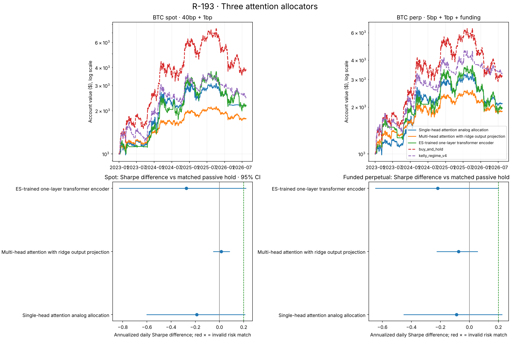

# R-193 — three attention allocators: results

Frozen protocol: [`experiments/r193_protocol.md`](../../experiments/r193_protocol.md) ·
notes: [`experiments/r193_research_notes.md`](../../experiments/r193_research_notes.md) ·
code: [`experiments/r193_strategies.py`](../../experiments/r193_strategies.py) ·
ledger: R-193 in [`docs/LEDGER.md`](../../docs/LEDGER.md).

**Verdict: NEGATIVE for all three primaries** under R-191's seven-gate rule, applied unchanged.
Manifest frozen 2026-11-18T15:21:27Z before any holdout cell. Training-only lead: `r193_attention`.
Trial SD 0.418538; program trials 4,850.

## Gates

| primary | matched edge | intervals | absolute growth | falsification (ETH/fees/funding) | plateau | DSR ≥ .95 | windows ≥ 13/24 | DSR spot / funded | window wins spot · funded | verdict |
|---|---|---|---|---|---|---|---|---|---|---|
| `r193_attention` | **fail** | **fail** | **fail** | **fail** | **fail** | **fail** | **fail** | 0.095 / 0.078 | 6/24 · 6/24 | NEGATIVE |
| `r193_multihead` | **fail** | **fail** | **fail** | **fail** | **fail** | **fail** | **fail** | 0.172 / 0.089 | 13/24 · 2/24 | NEGATIVE |
| `r193_transformer` | **fail** | **fail** | **fail** | **fail** | **fail** | **fail** | **fail** | 0.061 / 0.045 | 7/24 · 8/24 | NEGATIVE |

No cell of any configuration liquidated.

## Matched-passive comparisons (paired 30-day block bootstrap, 2,000 draws, seed 191)

| primary | cell | Sharpe | matched hold | ΔSharpe [95% CI] | Δlog growth [95% CI] | Δdaily max DD (pp) |
|---|---|---:|---:|---|---|---:|
| `r193_attention` | inner_val | 0.269 | -0.004 | +0.274 [-0.535, +0.995] | +0.190 [-0.271, +0.706] | -12.1 |
| `r193_multihead` | inner_val | -0.091 | -0.001 | -0.090 [-0.207, +0.044] | -0.043 [-0.109, +0.018] | +0.3 |
| `r193_transformer` | inner_val | 0.072 | -0.002 | +0.074 [-0.362, +0.444] | +0.084 [-0.393, +0.619] | -0.9 |
| `r193_attention` | funded_val | 0.131 | -0.101 | +0.232 [-0.229, +0.598] | +0.215 [-0.130, +0.606] | -5.9 |
| `r193_multihead` | funded_val | -0.180 | -0.127 | -0.053 [-0.312, +0.156] | -0.054 [-0.299, +0.186] | +3.4 |
| `r193_transformer` | funded_val | -0.027 | -0.108 | +0.081 [-0.159, +0.327] | +0.115 [-0.223, +0.483] | -0.6 |
| `r193_attention` | holdout | 0.858 | 1.047 | -0.188 [-0.604, +0.213] | -0.201 [-0.662, +0.269] | -7.7 |
| `r193_multihead` | holdout | 1.049 | 1.035 | +0.014 [-0.054, +0.085] | +0.010 [-0.030, +0.051] | -1.4 |
| `r193_transformer` | holdout | 0.735 | 1.010 | -0.275 [-0.830, +0.220] | -0.392 [-1.226, +0.345] | -0.3 |
| `r193_attention` | funded_holdout | 0.797 | 0.885 | -0.088 [-0.454, +0.227] | -0.101 [-0.555, +0.313] | -2.2 |
| `r193_multihead` | funded_holdout | 0.840 | 0.914 | -0.074 [-0.227, +0.058] | -0.067 [-0.197, +0.054] | -2.1 |
| `r193_transformer` | funded_holdout | 0.656 | 0.874 | -0.218 [-0.650, +0.203] | -0.324 [-0.967, +0.304] | +3.0 |

## Final balances from $1,000 (all nine configurations and both controls)

| strategy | inner_train | inner_val | funded_val | holdout | discount_holdout | funded_holdout | eth_holdout |
|---|---:|---:|---:|---:|---:|---:|---:|
| `buy_and_hold` | $29,913 | $573 | $481 | $3,827 | $3,839 | $3,137 | $1,566 |
| `kelly_regime_v4` | $13,296 | $869 | $983 | $2,454 | $3,392 | $3,193 | $1,662 |
| `r193_attention` | $3,770 | $1,068 | $920 | $2,179 | $2,215 | $2,099 | $1,336 |
| `r193_attention_high` | $3,448 | $927 | $833 | $1,915 | $1,925 | $1,390 | $1,279 |
| `r193_attention_low` | $3,832 | $1,151 | $1,086 | $2,072 | $2,148 | $2,056 | $1,533 |
| `r193_multihead` | $586 | $903 | $655 | $1,759 | $1,767 | $1,871 | $1,432 |
| `r193_multihead_high` | $612 | $931 | $664 | $1,552 | $1,558 | $2,244 | $1,394 |
| `r193_multihead_low` | $651 | $850 | $660 | $1,998 | $2,006 | $2,072 | $1,440 |
| `r193_transformer` | $1,519 | $742 | $576 | $2,161 | $2,508 | $1,957 | $1,322 |
| `r193_transformer_high` | $746 | $392 | $645 | $1,697 | $2,000 | $2,897 | $816 |
| `r193_transformer_low` | $896 | $784 | $620 | $2,124 | $2,538 | $2,370 | $648 |

Descriptive extras: [`linear_comparator.csv`](linear_comparator.csv) (R-191 `r191_cost_proximal`, same sizer, trailing-mean drift)
and [`exposure.csv`](exposure.csv) (target paths; the transformer holds > 0.9 on ~78% of holdout days).
Training power: [`training_power.csv`](training_power.csv) (1.8–51.5 years needed for +0.20 Sharpe).

## Counts

317 core evaluations + 348 matching attempts = **665 financial evaluations**;
holdout consultations **+618**, cumulative ~4,850.

